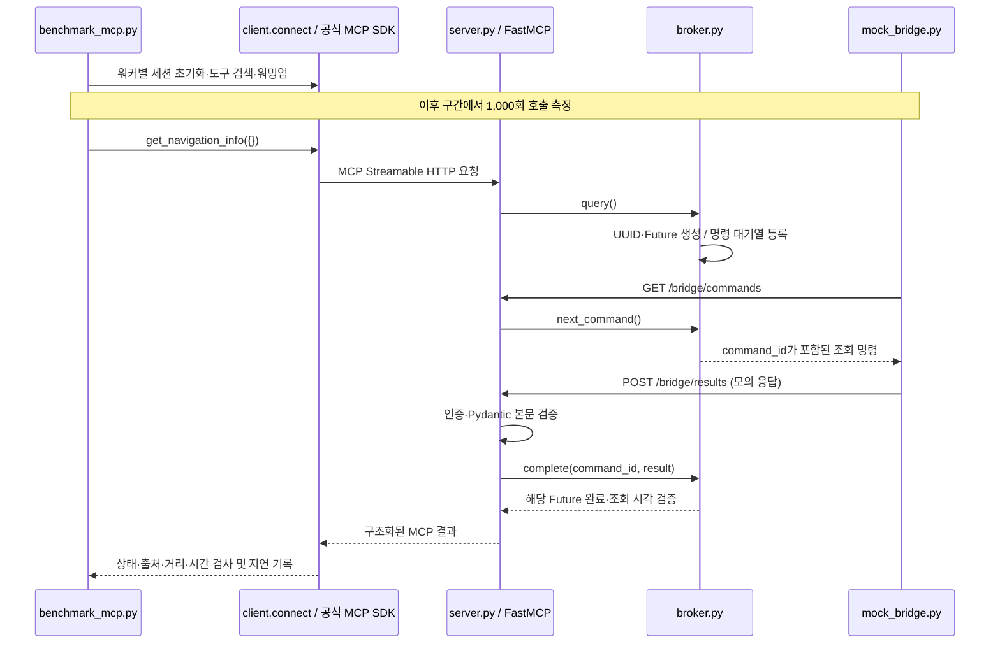

# Vehicle MCP 검증 결과 및 코드 역할 정리

작성일: 2026-10-28 (한국 시간)  
대상 프로젝트: FirstF1ame/HyundaiMCP  
주요 근거: [bridge-c16-1000-r1.json](docs/benchmarks/bridge-c16-1000-r1.json)

**2026-10-28 Android 보완:** 사용자가 SDK 연결 성공과 내장 앱의 경로 안내 화면을 확인했다. 기존 0.2.0은 `isRouting=false`이면 목적지 API를 호출하지 않는 가드 때문에 `no_destination`을 반환할 수 있었다. 0.2.1은 이 가드를 제거하고 목적지 콜백을 직접 확인한다. 응답이 없으면 `sdk_error`로 처리하며 실제 데이터 수신 성공은 사용자 AVD에서 재확인해야 한다. Python 모의 성능 결과는 이 변경의 영향을 받지 않는다.

## 1. 현재 확인된 결과

**Windows의 로컬 MCP 서버와 Python Bridge 시뮬레이터를 대상으로, 동시 요청 워커 16개가 총 1,000회 호출을 수행했고 모두 정상 모의 응답을 받았다.**

| 항목 | 결과 | 근거 범위 |
| --- | --- | --- |
| 모의 Bridge 성능 측정 | 1,000/1,000회 `ok`, 성공률 100% | 사용자가 제출한 원본 JSON |
| 처리량 | 306.4회/초 | 세션 초기화·워밍업을 제외한 측정 구간 |
| 정상 호출 지연 | 평균 51.889ms, p95 55.855ms | MCP 요청부터 결과 수신·검사까지 |
| 사용자 PC의 장애·동시성 테스트 | `9 passed, 2 deselected in 7.94s` | 사용자가 공유한 pytest 출력 |
| 클라우드의 기존 Python 전체 테스트 | 12개 통과 이력 | 앞선 개발·검증 실행 기록 및 `VALIDATION.md` |
| Android JVM 단위 테스트 | 최초 6개 + 조회 회귀 12개 = 현재 18개 통과 | 0.2.1 클라우드 검사 |
| Android APK 빌드·서명 검사·Lint | 통과 이력 | 앞선 APK 제작 시 검사 기록 |
| Pleos AVD의 실제 내비게이션 조회 | SDK 연결·내장 안내 화면 확인, 정상 목적지 응답 미확인 | 사용자 화면 및 0.2.1 AVD 재검증 필요 |
| 실제 GPT API·실차 동작 | 미검증 | 이번 벤치마크에 포함되지 않음 |

여기서 **통과**는 실행한 시나리오의 조건을 만족했다는 뜻이다. 제품의 SLA, 최대 처리량, 장시간 안정성에 대한 별도 합격 기준을 충족했다는 의미는 아니다. 이 문서 작성 과정에서는 원본 JSON과 코드 내용을 대조했으며, 과거의 모든 테스트를 새로 실행한 것은 아니다.

## 2. 근거 자료와 버전 범위

### 2.1 원본 성능 보고서

| 항목 | 값 |
| --- | --- |
| 파일 | `docs/benchmarks/bridge-c16-1000-r1.json` |
| SHA-256 | `3a229168e554d4ed9fadaec1025131933bccda8fd204506806350ff8e5b3230b` |
| 측정 시작 | 2026-10-28 19:42:38.615863 KST |
| JSON의 원본 시각 | `2026-10-28T10:42:38.615863+00:00` |
| 라벨 | `bridge-c16-1000-r1` |
| OS | Windows |
| Python | 3.13.5 |
| MCP Python SDK | 1.30.0 |
| 기대 출처 | `mock_bridge` |
| CPU·메모리·전원 모드 | JSON에 기록되지 않음 |

원본 JSON은 첨부 파일과 바이트가 동일하게 보존했다. 파일 안에는 토큰 값이나 실제 차량의 내비게이션 데이터가 포함되어 있지 않다.

### 2.2 코드 배포 상태와 해석 범위

문서 작성 시 확인한 `main`은 `771a0a7683756c9a4b13f4fa92567db0552c212a`다. 현재 작업 공간에는 이후 제작한 Android 앱과 벤치마크 스크립트도 존재한다. 이 문서는 **현재 작업 공간의 구현**을 기준으로 역할을 설명한다. Android 앱은 배포한 소스 ZIP, 벤치마크 스크립트는 `avd-test-artifacts` 브랜치에서 별도로 제공한 버전이므로, 모든 파일이 위 main 커밋에 들어 있다고 가정하면 안 된다.

사용자 JSON에는 Git 커밋이나 스크립트 해시가 없다. 따라서 사용자 PC에서 실행한 전체 코드가 특정 커밋과 완전히 같다는 사실까지 JSON만으로 증명할 수는 없다.

## 3. 시스템 구조와 실제 측정 경로

### 3.1 이번 벤치마크의 경로



MCP 서버와 Bridge 사이의 폴링·결과 POST는 프로젝트가 정의한 별도 HTTP 규약이다. 이 구간 자체를 MCP 프로토콜이라고 부르지는 않는다. 공식 MCP SDK는 클라이언트와 서버 사이의 초기화, 도구 검색, 도구 호출을 담당한다.

### 3.2 측정에 포함되지 않은 별도 경로

- Android 경로: `VehicleBridgeLoop` → `PleosNavigationProvider` → NaviHelper → 호환 Navi Service/내비게이션 앱.
- GPT 경로: `client.ask_gpt()` → OpenAI API의 함수 호출 요청 → 로컬 Host의 실제 MCP 호출 → 모델에 결과 반환.

이번 JSON을 만든 실행은 **Android·AVD·Pleos SDK·OpenAI API를 거치지 않는다.**

## 4. 벤치마크 방법과 성공 판정

측정 도구: [scripts/benchmark_mcp.py](https://github.com/FirstF1ame/HyundaiMCP/blob/avd-test-artifacts/benchmark_mcp.py)

1. 16개 워커가 각각 HTTP 클라이언트와 공식 MCP `ClientSession`을 만든다.
2. 세션 초기화 시간을 별도로 기록한다.
3. 도구 목록이 `get_navigation_info` 하나인지 확인한다.
4. 워커마다 1회씩 워밍업 호출을 하고 정상 응답인지 확인한다.
5. `asyncio.Barrier`로 모든 워커의 준비 완료를 기다린다.
6. 워커별로 한 번에 하나씩 호출하고 결과를 받은 뒤 다음 호출을 시작한다.
7. **전체 합계 1,000회**를 기록하고 JSON을 저장한다.

이는 **closed-loop 부하**다. 일정한 초당 유입량을 강제로 발생시키는 방식이 아니며, 16개 워커는 최대 16개 호출을 동시에 진행할 수 있다. 서버는 `stateless_http=True`로 설정되어 있으므로, 클라이언트 SDK 세션 16개가 서버 측 영속 세션 16개를 의미하지는 않는다.

### 4.1 측정 호출의 `ok` 조건

| 검사 | 필요한 값 |
| --- | --- |
| MCP 도구 오류 | `result.isError`가 false |
| 업무 상태 | `structuredContent.status == "ok"` |
| 출처 | `structuredContent.source == "mock_bridge"` |
| 거리 | `remaining_distance_m == 12300` |
| 시간 | `remaining_duration_s == 1080` |

`mock_bridge.py`가 생성하는 고정 합성 데이터를 대상으로 한 계약이다. 측정 도구는 목적지명이나 `observed_at`의 정확성을 직접 비교하지 않는다. 서버의 데이터 검증 로직은 별도로 실행되지만, 이것이 실제 지도·차량 데이터의 정확도를 증명하지는 않는다.

### 4.2 지연과 처리량에 포함되는 구간

- 호출 지연: `session.call_tool()` 직전부터 MCP 결과 수신 및 스크립트의 응답 검사가 끝날 때까지.
- 포함: 로컬 HTTP, MCP SDK 처리, 서버·Broker 처리, Bridge 폴링/결과 전송 및 OS 스케줄링의 영향.
- 제외: Python 프로그램 시작, 세션 초기화, 도구 검색, 워밍업, 보고서 파일 저장.
- 처리량: 첫 측정 호출 시작부터 마지막 측정 호출 완료까지의 성공 건수/경과 시간.
- 백분위수: 정렬한 표본에 nearest-rank 방식 적용. 예를 들어 1,000개 중 p95는 950번째 값이다.

워커당 워밍업 1회가 제외되므로 1,000개 표본 외에 **워밍업 도구 호출 16회**도 수행된다.

## 5. 1,000회 측정 결과

### 5.1 호출 성능

| 지표 | 원본 값 | 해석 |
| --- | ---: | --- |
| 전체 요청 | 1,000회 | 워커 전체 합계 |
| 동시성 설정 | 16 | 워커마다 한 번에 1개 호출 |
| 성공 | 1,000회 | 모든 표본 `ok` |
| 성공률 | 1.0 = 100% | 이번 표본에서 실패 없음 |
| 측정 구간 | 3.264초 | 준비 시간 제외 |
| 완료 처리량 | 306.4회/초 | 성공 처리량과 같음 |
| 평균 지연 | 51.889ms | 전체 호출이 성공이므로 전체 평균과 같음 |
| p50 | 51.888ms | 50%가 이 시간 이내 완료 |
| p95 | 55.855ms | 95%가 이 시간 이내 완료 |
| p99 | 58.322ms | 99%가 이 시간 이내 완료 |
| 최대 | 77.500ms | 이번 표본의 가장 느린 호출 |

저장된 `elapsed_seconds`는 소수점 셋째 자리까지 반올림되어 있다. `1000 / 3.264`로 재계산한 값과 JSON의 306.4회/초 사이에 생기는 작은 차이는 반올림 정밀도 차이로 설명된다.

### 5.2 세션 초기화

| 지표 | 원본 값 |
| --- | ---: |
| 표본 수 | 16개 |
| 평균 | 2,272.040ms |
| p50 | 2,132.791ms |
| p95 | 4,302.215ms |
| p99 | 4,302.215ms |
| 최대 | 4,302.215ms |

초기화는 `connect()` 진입부터 SDK 초기화가 완료된 세션을 얻을 때까지다. `list_tools()`와 워밍업은 이 값에도 포함되지 않는다. 16개가 함께 준비되는 실행에서 얻은 값이므로 **단일 사용자 최초 연결 시간**으로 그대로 일반화할 수 없다.

초기화 표본은 16개뿐이어서 nearest-rank p95·p99가 모두 최댓값과 같다. 초기화 지연은 별도의 동시성 비교와 반복 측정이 필요하며, 현재 JSON으로 원인을 특정할 수 없다.

### 5.3 원본 개별 표본 대조

문서 작성 시 원본 `samples`를 다시 집계했다.

| 확인 항목 | 대조 결과 |
| --- | --- |
| 표본 수 | 1,000개 |
| `request` 순번 | 0~999가 각 1회씩 존재 |
| 개별 상태 | `ok` 1,000개 |
| 워커 번호 | 0~15, 총 16개 |
| 워커별 분배 | 0~7번 각 63회, 8~15번 각 62회 |
| 재계산 p95/p99 | 55.855ms / 58.322ms로 요약과 일치 |

**`samples.request`는 벤치마크의 순번이며 Broker의 UUID `command_id`가 아니다.** 표본 순번의 유일성이 실제 Bridge 응답의 요청 ID 매칭을 증명하지는 않는다. 모든 부하 응답에 같은 값이 사용되므로, 요청 간 결과 혼선은 값이 다른 역순 응답을 사용하는 별도 테스트로 검증한다.

### 5.4 앞선 100회 실행과 비교

100회 결과는 사용자가 채팅에 공유한 요약이며 원본 JSON은 이 문서에 첨부하지 않았다.

| 지표 | 앞선 100회 | 이번 1,000회 |
| --- | ---: | ---: |
| 동시성 | 16 | 16 |
| 성공률 | 100% | 100% |
| 처리량 | 297.264회/초 | 306.400회/초 |
| 평균 | 50.104ms | 51.889ms |
| p50 | 51.537ms | 51.888ms |
| p95 | 66.677ms | 55.855ms |
| p99 | 79.068ms | 58.322ms |
| 최대 | 82.074ms | 77.500ms |

측정 규모를 늘린 실행에서도 평균은 비슷했고, 이번 실행의 p95·p99는 더 낮았다. **같은 코드의 서로 다른 실행 비교이므로 코드 최적화 효과나 통계적 성능 개선으로 단정하지 않는다.**

## 6. 통과한 기능 검증과 테스트 연결

### 6.1 사용자 PC에서 통과한 선택 테스트 9개

명령:

```powershell
.\.venv\Scripts\python.exe -m pytest -q tests/test_mcp.py -k "timeout or offline or round_trip or concurrent"
```

사용자가 공유한 결과:

```text
9 passed, 2 deselected in 7.94s
```

`2 deselected`는 필터에서 제외된 테스트이며 실패나 실행 중 skip이 아니다. 7.94초는 pytest 전체 수행 시간이며 개별 MCP 응답 지연이 아니다.

| 테스트 함수 | 실행 수 | 검증한 행동 |
| --- | ---: | --- |
| `test_bridge_offline_never_falls_back_to_mock` | 1 | Bridge 미접속 시 `bridge_offline`; 성공 모의 값으로 대체하지 않음 |
| `test_mcp_to_bridge_round_trip` | 6 | `ok`, `no_destination`, `sdk_error`, `unsupported`, 60초 과거·60초 미래 응답 처리; 각 실행에서 중복 POST 409 거부 |
| `test_invalid_bridge_data_and_timeout` | 1 | 음수 남은 시간을 HTTP 422로 거부; 유효 결과가 없으면 `timeout` |
| `test_concurrent_calls_keep_their_own_results` | 1 | 거리 111/222의 서로 다른 응답을 역순 전송해도 각 호출에 정확히 연결 |

제외된 2개는 같은 파일의 도구 검색/미등록 도구 거부 테스트와 인증 토큰 분리 테스트다.

### 6.2 기존 Python 전체 테스트 12개 통과 이력

파일: `tests/test_mcp.py`, `tests/test_gpt_host.py`

위 9개에 다음 3개를 더해 총 12개다. 클라우드 개발환경의 전체 테스트 통과 이력이 있으며, 사용자 PC의 선택 테스트 결과 9개와 구분한다.

| 테스트 함수 | 실행 수 | 검증한 행동 |
| --- | ---: | --- |
| `test_actual_mcp_discovery_call_and_no_arbitrary_tools` | 1 | 실제 HTTP MCP 초기화·도구 검색·호출; 읽기 전용 힌트; 미등록 `set_destination` 도구 거부 |
| `test_role_tokens_and_missing_credentials` | 1 | 인증 누락 401; MCP/Bridge 토큰의 교차 사용 거부; 정상 health 호출 |
| `test_model_call_reaches_real_mcp_and_result_returns` | 1 | 가짜 모델의 함수 호출을 실제 로컬 MCP로 전달하고 결과를 같은 `call_id`로 반환 |

GPT 테스트는 `AsyncOpenAI`를 가짜 객체로 바꾼다. 출력에 시뮬레이션 문구가 나타나는 것은 가짜 모델 응답을 통한 검증이며, **실제 모델이 단위 변환이나 안전 지침을 따르는지 검증한 결과가 아니다.** OpenAI 패키지가 없는 환경에서는 해당 테스트가 skip될 수 있으므로, 재실행 시 passed/skip 수를 함께 확인한다.

### 6.3 Android JVM 테스트 6개 통과 이력

실제 AVD 대신 JVM과 MockWebServer를 사용하는 테스트다.

| 파일 / 테스트 함수 | 검증한 행동 |
| --- | --- |
| `NavigationResultTest.destinationFieldsPreserveSdkUnitsAndObservationTime` | 목적지·미터·초·시각을 JSON으로 보존 |
| `NavigationResultTest.failuresNeverContainNavigationValues` | 오류/미지원/목적지 없음 응답에서 내비게이션 값 제외 |
| `NavigationResultTest.invalidSuccessBecomesErrorInsteadOfInventedValues` | 누락·공백 목적지·음수·긴 목적지명을 `sdk_error`로 변환 |
| `NavigationResultTest.zeroDistanceAndDurationAreValid` | 거리·시간 0을 정상 값으로 허용 |
| `VehicleBridgeLoopTest.commandIdAndSdkResultReachCorrectEndpointWithBridgeToken` | HTTP 경로·Bearer 헤더·명령 ID·결과 전달 확인; 다음 poll의 401로 루프 종료 |
| `VehicleBridgeLoopTest.wrongServerModeStopsPollingAndReportsActionableError` | poll의 409 응답에서 SDK 조회 없이 종료하고 bridge 모드 안내 |

첫 Bridge 테스트에서 `SDK result`는 테스트용 Provider가 만든 값이다. NaviHelper 서비스 호출을 실행한 테스트가 아니다.

### 6.4 빌드·패키지 검사 이력

| 검사 | 확인된 범위 |
| --- | --- |
| `pip check` | 설치된 Python 패키지의 선언된 의존성 충돌 없음 |
| `:app:assembleDebug` | Android 소스·SDK 참조·리소스를 컴파일하여 debug APK 생성 |
| `:app:lintDebug` | 최종 APK 제작 시 정적 검사 오류·경고 0건 |
| `apksigner verify` | APK 서명 유효성. 배포자 인증이나 실차 설치 승인을 의미하지 않음 |

Android 빌드 이력의 도구는 Gradle 8.9, AGP 8.7.3, Kotlin 1.9.25, JDK 21, SDK 34다. 사용자 성능 측정 환경의 Windows/Python 3.13.5와는 별개 환경이다.

## 7. Python 서버·클라이언트 코드의 역할

### 7.1 `vehicle_mcp/server.py` — MCP 도구와 HTTP 진입점

| 구성 요소 | 역할 | 다른 코드와의 연결 |
| --- | --- | --- |
| `TokenGate` | 모든 HTTP 요청의 경로에 맞는 Bearer 토큰 검사; `hmac.compare_digest`로 비교 | `/bridge/`는 `BRIDGE_TOKEN`, 나머지는 `MCP_TOKEN` |
| `create_app(settings)` | Broker, FastMCP, FastAPI를 구성하고 인증 래퍼 반환 | 테스트마다 독립 설정·대기열 생성 가능 |
| `FastMCP(...)` | 공식 SDK로 MCP 도구 등록·프로토콜 처리 | `stateless_http=True`, JSON 응답 |
| `get_navigation_info()` | 인자 없는 유일한 조회 도구 | mock이면 고정 값, bridge이면 `Broker.query()` |
| `lifespan()` | 서버 시작/종료에 맞춰 MCP 세션 관리자 실행·정리 | FastAPI 수명 주기와 연결 |
| `GET /health` | 서버가 살아 있는지와 현재 모드 반환 | 내비게이션 앱이나 SDK 연결 정상 여부는 보장하지 않음 |
| `GET /bridge/commands` | Bridge가 대기 중인 명령을 가져가는 long polling | `Broker.next_command()`; 없으면 HTTP 204 |
| `POST /bridge/results` | Bridge 응답을 검증하고 해당 명령에 연결 | `BridgeResult` → `Broker.complete()`; 수신 불가 시 409 |
| `api.mount("/", ...)` | MCP HTTP 요청을 공식 SDK 앱으로 전달 | 앞서 선언한 health/bridge 경로와 공존 |
| `main()` | 환경설정 로드 후 Uvicorn 실행 | `127.0.0.1`, 기본 포트 8000, 단일 worker |

도구의 `readOnlyHint`, `destructiveHint` 등은 클라이언트에 제공하는 메타데이터다. 실제로도 조회 도구만 등록되어 있지만, 힌트 자체가 권한 검사를 대신하지는 않는다.

`bridge` 모드에서 `/bridge/`의 명령 큐/응답 처리가 활성화된다. `mock` 모드의 Bridge API 호출은 HTTP 409로 거부한다.

### 7.2 `vehicle_mcp/broker.py` — 요청·명령·응답 연결

| 구성 요소 | 역할 |
| --- | --- |
| `Pending.future` | 하나의 MCP 호출이 기다리는 비동기 결과 자리 |
| `Pending.delivered` | 해당 명령을 Bridge에 실제 전달했는지 표시 |
| `pending` | `command_id → Pending` 딕셔너리 |
| `queue` | Bridge에 보낼 명령 ID 대기열; 최대 크기 16 |
| `last_poll` | Bridge의 마지막 명령 poll 시각; monotonic clock 사용 |
| `query()` | 연결 상태·용량 확인 → UUID 생성 → 대기열 등록 → Future 대기 → 결과 시각 확인 |
| `next_command()` | 최대 10초 동안 유효한 명령을 기다려 Bridge에 전달; 이미 만료된 큐 항목은 건너뜀 |
| `complete()` | 전달된 활성 명령의 Future를 완료; 중복·만료·미전달·알 수 없는 ID는 false |
| `query()`의 `finally` | 성공·시간 초과·취소 시 `pending`에서 해당 요청 정리 |

요청마다 Future와 UUID를 따로 두기 때문에 두 Bridge 결과가 역순으로 들어와도 원래 호출자에게 연결할 수 있다.

메모리 큐이므로 서버 재시작 시 진행 중인 요청은 유지되지 않는다. 서버 worker를 여러 개 띄우면 메모리가 공유되지 않아 현재 방식으로는 명령·응답 연결을 보장할 수 없다.

### 7.3 `vehicle_mcp/models.py` — Bridge 응답 계약 검증

| 구성 요소 | 역할 |
| --- | --- |
| `NavigationSnapshot` | Bridge가 반환하는 내비게이션 데이터 규격 |
| `ConfigDict(extra="forbid")` | 규격에 없는 필드 거부 |
| `AwareDatetime` | 시간대 없는 시각 거부. UTC 문자열만 강제하는 타입은 아니며 비교 시 시각 의미를 사용 |
| `Field(..., ge=0, strict=True)` | 거리·시간의 음수 및 문자열/실수의 정수 자동 변환 거부 |
| `valid_state()` | `ok`이면 목적지·거리·시간이 모두 필요; 오류이면 내비게이션 값이 없어야 함 |
| `BridgeResult` | `command_id`와 `NavigationSnapshot`을 묶은 POST 본문 |

`command_id` 필드는 길이 36을 검사한다. 입력 문자열이 올바른 UUID 형식인지 별도로 파싱하는 것은 아니며, 실제 수신 가능 여부는 Broker의 기존 ID 매칭으로 확인한다.

### 7.4 `vehicle_mcp/config.py` — 실행 설정과 사전 검증

| 구성 요소 | 역할 |
| --- | --- |
| `Settings` | 실행 설정을 담는 변경 불가 dataclass |
| `__post_init__()` | 모드, 토큰 최소 길이, 토큰 중복, 명령 대기 시간 범위 검증 |
| `settings_from_env()` | `.env` 및 프로세스 환경변수를 읽어 Settings 생성 |

`load_dotenv()`는 이미 설정된 환경변수를 기본적으로 덮어쓰지 않는다. 따라서 PowerShell에서 `$env:VEHICLE_MODE`를 바꾸면 `.env`의 모드보다 우선한다. 변경은 해당 터미널에서 시작한 프로세스에 적용된다.

### 7.5 `vehicle_mcp/client.py` — MCP 호출자 및 선택적 GPT Host

| 구성 요소 | 역할 |
| --- | --- |
| `connect()` | 환경설정 로드 → Bearer 헤더가 있는 HTTP 클라이언트 생성 → Streamable HTTP 연결 → MCP 초기화 → 종료 시 정리 |
| `probe()` | 도구 목록을 출력하고 `get_navigation_info` 1회 호출 |
| `ask_gpt()` | 발견한 허용 도구를 OpenAI 함수 정의로 전달하고, 모델의 호출 요청을 실제 MCP로 중계 |
| `allowed` | `get_navigation_info`만 모델에 노출하는 허용 목록 |
| 호출 인자 검사 | 도구가 인자를 받지 않으므로 JSON `{}`만 허용 |
| `history` / `call_id` | 모델의 함수 호출과 MCP 결과를 같은 호출 ID로 연결 |
| 최대 4회 반복 | 모델의 도구 호출 루프가 무한히 이어지지 않게 제한 |
| `main()` | `--ask`가 없으면 probe, 있으면 GPT 경로 선택 |

`probe()`는 `result.isError`일 때 예외를 발생시키지만, `status=timeout` 같은 업무 실패 상태를 전부 프로세스 실패로 바꾸지는 않는다. 단순히 클라이언트 명령의 종료 코드가 0이라는 이유만으로 내비게이션 조회 성공이라고 판단하면 안 된다. 성능 도구는 `status`, `source`, 거리·시간까지 검사한다.

GPT 서버가 localhost의 MCP에 직접 접속하는 구조가 아니다. 로컬 Host가 OpenAI API와 MCP 양쪽에 연결한다. 실제 API를 선택하면 목적지·거리·시간이 OpenAI에 전달될 수 있다.

### 7.6 기타 Python 파일

| 파일 | 역할 |
| --- | --- |
| `vehicle_mcp/__init__.py` | Python 패키지 표시 및 프로젝트 설명 |
| `scripts/init_env.py` | 서로 다른 난수 토큰으로 `.env` 최초 생성; `open("x")`로 기존 파일 덮어쓰기 방지 |
| `scripts/mock_bridge.py` | Bridge 명령 폴링 → 같은 command_id로 고정 합성 데이터 POST; `source=mock_bridge` |
| `scripts/benchmark_mcp.py` | 공식 SDK 세션·워밍업·동시 호출·시간 측정·응답 판정·JSON 저장 |
| `tests/test_mcp.py` | 임시 포트 실제 HTTP 서버와 공식 MCP 클라이언트를 사용하는 통합 테스트 |
| `tests/test_gpt_host.py` | 가짜 OpenAI 응답과 실제 로컬 MCP를 결합한 Host 경계 테스트 |

`init_env.py`는 한 번 생성에 성공한 뒤 다시 실행하면 기존 파일 때문에 실패한다. 이는 토큰을 보호하기 위한 동작이다. `mock_bridge.py`는 실제 Pleos SDK가 아니며, 새 요청마다 같은 거리·시간을 생성한다. 현재 시뮬레이터에는 임의 지터·손실률·SDK 오류를 CLI로 설정하는 기능이 없다.

### 7.7 측정 도구와 테스트 도우미의 세부 역할

| 파일 / 함수 | 역할 |
| --- | --- |
| `benchmark_mcp.py: latency_summary()` | 평균과 nearest-rank p50/p95/p99/최댓값 계산; 표본이 없으면 null |
| `benchmark_mcp.py: benchmark()` | 시작 시각, 워커 그룹, 측정 구간, 상태 집계 및 보고서 구성 |
| `benchmark_mcp.py: check()` | MCP 오류·업무 상태·출처·고정 거리/시간을 확인해 표본 상태 분류 |
| `benchmark_mcp.py: worker()` | 독립 세션 초기화, 검색·워밍업, Barrier 대기, 배정된 호출 수행 |
| `benchmark_mcp.py: main()` | CLI 값 검사, 기존 출력 파일 보호, JSON 저장, 전부 성공한 경우에만 종료 코드 0 |
| `test_mcp.py: running()` | 임시 포트에 실제 Uvicorn 서버를 띄우고 테스트 후 종료 |
| `test_mcp.py: session_at()` | 공식 SDK의 인증된 MCP 세션 생성·초기화·종료 |
| `test_mcp.py: snapshot()` | 상태와 시각 차이를 조절해 정상·오류·오래된 응답 데이터 생성 |
| `test_gpt_host.py: FakeResponses/FakeAI` | 실제 모델 API를 호출하지 않고 함수 호출 요청과 후속 답변을 재현 |

`samples` 배열은 요청 순번 기준으로 정렬되어 저장된다. 여러 워커가 섞여 있으므로 배열의 앞/뒤 구간이 그대로 시간순이라고 가정해서는 안 된다. 현재 보고서에는 개별 호출의 절대 시작/종료 시각이 없다.

## 8. Android 코드의 역할

아래 경로의 공통 접두사는 `android/app/src/main/java/example/vehiclemcp/`다. Android 구현 설명은 코드 검토에 근거하며, 이번 1,000회 성능 측정에 포함된 구성 요소는 아니다.

### 8.1 `MainActivity.kt` — AVD 테스트 화면과 수명 주기

| 구성 요소 | 역할 |
| --- | --- |
| `onCreate()` | SDK 상태·조회 버튼·응답 JSON·Bridge 토큰·시작/중지 버튼 구성 |
| 조회 버튼 | `readSnapshot()` 호출; 중복 수동 조회와 Bridge 동작 중 수동 조회 제한 |
| Bridge 버튼 | 입력 토큰 길이 확인 후 `VehicleBridgeLoop` 시작/중지 |
| `onStart()` | 화면 진입마다 새 CoroutineScope와 SDK Provider 생성·초기화 |
| `onStop()` | 작업 취소, SDK 종료, 토큰 및 화면 결과 제거 |
| `FLAG_SECURE` | 화면 캡처와 비보안 디스플레이 노출을 제한하는 Android 플래그 |
| 토큰 입력 설정 | 비밀번호 형태 표시, 상태 자동 저장 비활성화, 메모리에서만 사용 |

현재 Bridge 주소는 `http://127.0.0.1:8000`으로 고정되어 있다. AVD에서 `adb reverse`로 같은 PC의 Python 서버에 연결하는 개발용 설정이다. 화면을 떠나면 토큰이 지워지므로 목적지는 먼저 설정한 뒤 앱으로 돌아와 입력한다.

### 8.2 `PleosNavigationProvider.kt` — NaviHelper 어댑터

| 구성 요소 | 역할 |
| --- | --- |
| `NaviHelper(context.applicationContext)` | 공식 NaviHelper SDK 진입점 생성 |
| `start()` / `initialize()` | 서비스 연결 성공/실패 처리; 성공 후 리스너 등록 |
| `NavigationQuery`의 `Mutex` | 여러 SDK 조회가 겹치지 않도록 직렬화 |
| `NavigationQuery`의 `CompletableDeferred` | 목적지 콜백을 `suspend` 조회 함수와 연결 |
| `getRouteStateInfo()` | 경로 상태 진단 요청. 결과로 목적지 API 호출을 막지 않음 |
| `onRouteStateInfo()` | `isRouting`, `naviMode`를 화면 진단에 표시 |
| `getDestinationInfo()` | 목적지 데이터 요청 |
| `onDestinationInfo()` | `name`, `remainDistance`, `remainTime`을 `NavigationResult`로 매핑 |
| `onDestinationChanged()` | 변경 중인 경로의 결과 혼합을 피하도록 현재 대기에 오류 전달 |
| `onError()` | SDK 오류를 현재 대기에 전달하고 원문 대신 상태 안내 |
| `NavigationQuery.read()`의 `withTimeout(6000)` | 목적지 콜백 대기를 6초로 제한; 미응답은 `sdk_error` |
| `close()` | 콜백 작업 취소, 리스너 제거, SDK release |

공식 배포의 `NaviHelper:3.0.5` 및 `navi-data:3.0.4` 소스로 확인한 필드다. `remainDistance`는 미터, `remainTime`은 초다.

SDK 콜백에는 요청 ID와 원본 데이터 관측 시각이 없다. 앱은 조회를 직렬화하고 콜백 수신 시각을 기록하지만, 매우 늦게 온 이벤트가 어느 요청에 대응하는지나 SDK 내부 데이터가 얼마나 오래됐는지를 완전히 증명하지 못한다. Python Broker의 UUID 매칭과는 다른 제약이다.

### 8.3 `NavigationResult.kt` — Android → Bridge JSON 변환

- `status`, 콜백 수신 시각, 목적지명·거리·시간을 담는다.
- `toJson()`은 `source=pleos_sdk`와 `observed_at`을 포함한다.
- 성공인데 목적지/거리/시간이 잘못되면 `sdk_error`로 바꾸고 내비게이션 값은 제외한다.
- `no_destination`, `sdk_error`, `unsupported` 등 비정상 상태에는 목적지·거리·시간을 넣지 않는다.
- 거리·시간 0은 유효한 성공 값이다.

`source=pleos_sdk`는 이 어댑터 경로를 사용했다는 보고이며, 실제 차량의 데이터임을 인증하는 값은 아니다. AVD의 데이터 또한 실차 데이터와 구분해야 한다.

### 8.4 `VehicleBridgeLoop.kt` — Android Bridge 전송 루프

| 구성 요소 | 역할 |
| --- | --- |
| `NavigationProvider` | 실제 데이터 조회와 HTTP 전송을 분리하는 인터페이스 |
| `poll()` | Bridge 토큰으로 `/bridge/commands` 요청; 204이면 명령 없음 |
| `post()` | 원래 command_id와 Provider 결과를 `/bridge/results`에 전송 |
| `run()` | 명령 수신 → 허용 도구 확인 → Provider 조회 → 결과 전송 반복 |
| 401 응답 | 인증 실패를 안내하고 루프 종료 |
| poll의 409 | 서버를 bridge 모드로 실행하도록 안내하고 종료 |
| result POST의 409 | 만료/중복 등으로 거부된 결과임을 안내 |
| 잘못된 JSON | 서버 응답 형식 오류를 안내하고 종료 |
| I/O 오류 | 1초 지연 후 재시도 |
| `CancellationException` | 일반 SDK 오류로 바꾸지 않고 전파 |
| `unavailable()` | 조회 예외 등에 쓰는 숫자 없는 실패 응답 생성 |

HTTP 연결 제한은 연결 3초, 읽기 12초, 전체 호출 14초다. 블로킹 OkHttp 작업은 IO 디스패처에서 실행하므로, 취소 시 이미 진행 중인 I/O가 즉시 중단된다고 보장하는 구현은 아니다. 호출 제한 시간이 상한 역할을 한다. 따라서 실제 화면 이탈·재진입 동작도 AVD에서 확인해야 한다.

### 8.5 Android 프로젝트·리소스·테스트 파일

| 파일 | 역할 |
| --- | --- |
| `android/settings.gradle.kts` | app 모듈 등록; Google/Maven Central/Pleos 저장소 설정 |
| `android/build.gradle.kts` | Android Gradle Plugin 8.7.3 및 Kotlin 1.9.25 버전 지정 |
| `android/gradle.properties` | Gradle JVM 메모리·worker 수·AndroidX 등 로컬 빌드 설정 |
| `android/gradlew`, `android/gradlew.bat` | OS별 Gradle Wrapper 실행 진입점 |
| `android/gradle/wrapper/gradle-wrapper.jar` | Gradle Wrapper 실행 구현 |
| `android/gradle/wrapper/gradle-wrapper.properties` | Gradle 8.9 배포 주소 및 SHA-256 고정 |
| `android/app/build.gradle.kts` | minSdk 28, compile/targetSdk 34, JVM target 17, SDK·OkHttp·Coroutines·JUnit 의존성 |
| `android/app/src/main/AndroidManifest.xml` | 앱·Activity 등록; INTERNET와 조회용 NAVI_ROUTE 권한; Navi Service 패키지 가시성; 백업 정책 |
| `android/app/src/debug/AndroidManifest.xml` | debug 빌드에서만 로컬 네트워크 정책 추가 |
| `android/app/src/debug/res/xml/local_network_security.xml` | debug의 127.0.0.1에만 평문 HTTP 허용 |
| `android/app/src/main/res/values/strings.xml` | 테스트 화면의 한국어 문구 |
| `android/app/src/main/res/drawable/ic_vehicle.xml` | 앱 아이콘 |
| `android/app/src/main/res/xml/backup_rules.xml` | Android 12 미만의 백업 대상 제외 규칙 |
| `android/app/src/main/res/xml/data_extraction_rules.xml` | Android 12 이상의 클라우드 백업·기기 전송 제외 규칙 |
| `android/app/src/main/java/example/vehiclemcp/NavigationQuery.kt` | 목적지 요청·콜백·직렬화·오류 판정; false 경로 상태로 조회를 막지 않음 |
| `android/app/src/test/java/example/vehiclemcp/NavigationQueryTest.kt` | 목적지 조회 상태 머신의 회귀 테스트 12개 |
| `android/app/src/test/java/example/vehiclemcp/NavigationResultTest.kt` | 응답 변환 단위 테스트 4개 |
| `android/app/src/test/java/example/vehiclemcp/VehicleBridgeLoopTest.kt` | MockWebServer 기반 HTTP 전송 테스트 2개 |
| `android/README.md` | Android Studio·AVD 설치·실행·Bridge 연결 및 제약 안내 |

일반 SDK 패키지를 추가했다고 호환 내비게이션 앱이 함께 설치되는 것은 아니다. 조회용 `NAVI_ROUTE` 권한 선언도 호환 서비스의 제공 여부나 실제 권한 부여를 보장하지 않는다.

## 9. 공통 설정·문서·생성 파일

| 파일/디렉터리 | 역할 및 취급 |
| --- | --- |
| `pyproject.toml` | Python 패키지 메타데이터, 필수 의존성, gpt/test 선택 의존성, pytest 설정 |
| `requirements-lock.txt` | 재현 가능한 설치를 위한 직접·간접 Python 의존성 고정 목록 |
| `.gitignore` | `.env`, 가상환경, 캐시, Android 로컬 설정 및 빌드 출력 등을 Git에서 제외 |
| `README.md` | 프로젝트 개요, Python 실행 및 Bridge 계약 |
| `VALIDATION.md` | 이전 Python 및 Android 제작 시 검증 이력. 과거 기준과 현재 기준을 구분해 읽어야 함 |
| `MCP_VALIDATION_REPORT.md` | 본 문서. 사용자 성능 근거와 코드별 역할을 종합 |
| `docs/benchmarks/bridge-c16-1000-r1.json` | 이번 문서의 원본 증거 보존본 |
| `.env` | 로컬 토큰/실행 설정. 비밀값을 문서나 Git에 넣지 않음 |
| `.venv/` | Python 의존성 설치 위치. 소스가 아니라 로컬 환경 |
| `benchmark-results/*.json` | 사용자가 실행한 성능 측정 결과. 지정한 파일이 있으면 도구가 덮어쓰기를 거부 |
| `android/app/build/` | APK·JUnit·Lint 등 생성 결과. 소스와 구분 |
| `android/local.properties` | Android SDK의 PC별 경로. 공유하지 않는 로컬 설정 |

### 9.1 환경변수

| 이름 | 용도 | 기본값/제약 |
| --- | --- | --- |
| `VEHICLE_MODE` | 직접 mock 응답 또는 Bridge 대기 경로 선택 | `mock` / `bridge` |
| `MCP_TOKEN` | MCP 클라이언트·health 인증 | 최소 32자, Bridge 토큰과 달라야 함 |
| `BRIDGE_TOKEN` | Bridge 폴링·결과 POST 인증 | 최소 32자, MCP 토큰과 달라야 함 |
| `PORT` | Python HTTP 수신 포트 | 8000; Android 테스트 앱은 8000 고정 |
| `COMMAND_TIMEOUT_SECONDS` | 서버에서 명령 결과를 기다리는 시간 | 기본 12초, 0 초과·60초 이하 |
| `OPENAI_API_KEY` | 선택적 GPT Host 인증 | 이번 테스트에는 필요 없음 |
| `OPENAI_MODEL` | 선택적 GPT 모델 ID | 이번 테스트에는 필요 없음 |

### 9.2 시간·용량 제한

| 제한 | 구현 위치 | 의미 |
| --- | --- | --- |
| 서버 명령 대기 기본 12초 | `Settings` / `Broker.query()` | 넘으면 `timeout` |
| Bridge poll 최대 10초 | `Broker.next_command()` | 명령이 없으면 204 |
| 마지막 poll로부터 20초 초과 | `Broker.query()` | `bridge_offline` 판단 |
| pending 및 queue 한도 16 | `Broker` | 용량 초과 시 `busy` |
| 관측 시각 30초 초과 과거 | `Broker.query()` | `stale_data` |
| 관측 시각 5초 초과 미래 | `Broker.query()` | `stale_data` |
| Android SDK 조회 6초 | `PleosNavigationProvider` | 초과 시 `sdk_error` |

이 제한들이 코드에 존재한다는 사실과 경계 조건을 모두 테스트했다는 사실은 다르다. 예를 들어 `busy` 가드는 구현되어 있지만 이번 실행의 16개 동시성은 **한도 초과·포화 상태 검증이 아니다.**

## 10. 응답 데이터와 HTTP 상태를 읽는 법

### 10.1 업무 상태

| `status` | 의미 | 주로 만드는 위치 |
| --- | --- | --- |
| `ok` | 사용 가능한 값이 있는 응답 | mock 서버, 모의 Bridge, Android Provider |
| `no_destination` | 활성 경로/목적지가 없다는 응답 | Bridge/Provider |
| `sdk_error` | SDK 또는 조회 처리 실패 | Bridge/Provider |
| `unsupported` | 제공 기능 미지원 | Bridge/Provider |
| `bridge_offline` | 최근 Bridge poll이 없음 | Broker |
| `timeout` | 명령 결과가 제한 시간 내 도착하지 않음 | Broker |
| `busy` | 처리 중/대기 중 요청 용량 초과 | Broker |
| `stale_data` | 조회 시각이 허용 범위 밖 | Broker |

`wrong_source`, `wrong_values`, `mcp_error`, `exception:...`는 벤치마크가 분류하는 측정 실패 이름이며 서버의 내비게이션 상태 규격과 구분한다.

### 10.2 `source`

| 값 | 의미 |
| --- | --- |
| `mock` | Python 서버가 즉시 만든 고정 모의 값 |
| `mock_bridge` | 별도 시뮬레이터가 Bridge 왕복으로 반환한 모의 값 |
| `pleos_sdk` | SDK 어댑터가 보고하는 값. 실제 하드웨어 출처 인증이 아님 |
| `pleos_bridge` | Broker가 만든 offline/timeout/busy/stale_data 등의 상태 출처 |

### 10.3 Bridge HTTP 상태

| HTTP 상태 | 의미 |
| --- | --- |
| 200 | 정상 health/명령/결과 수락 등. 구체적인 본문을 함께 확인 |
| 204 | long polling이 끝났지만 받을 명령이 없음 |
| 401 | 토큰 누락·불일치 또는 다른 역할의 토큰 사용 |
| 409 | mock 모드의 Bridge API 호출, 또는 결과가 미전달·만료·중복·알 수 없는 명령에 해당 |
| 422 | FastAPI/Pydantic의 본문 규격 검증 실패 |

MCP 프로토콜 오류(`isError`)와 업무 실패(`status`), Bridge 전송의 HTTP 오류는 서로 다른 층이다. 로그나 결과를 설명할 때 혼용하지 않는다.

## 11. 아직 검증하지 않은 범위와 다음 확인 순서

| 항목 | 현재 상태 | 다음 확인 방법 |
| --- | --- | --- |
| 호환 내비게이션 앱/Navi Service | 실제 Pleos 이미지에서 내장 앱과 SDK 연결을 사용자 확인 | 0.2.1에서 목적지 콜백 수신 확인 |
| AVD SDK 초기화·권한·콜백 | 연결 성공 화면 확인; 목적지 콜백 성공은 미확인 | 0.2.1의 진단 이벤트와 실제 응답 비교 |
| Android → SDK → Python 전체 왕복 | 미검증 | 목적지 설정 후 `source=pleos_sdk`, 정상 상태·단위·데이터 변경 확인 |
| SDK 원본 관측 시각 | 원본 필드 없음 | 콜백 수신 시각과 센서 측정 시각을 구분해 설계 검토 |
| 실제 GPT 도구 선택·응답 품질 | 가짜 응답 테스트만 있음 | 사용자가 승인한 API 환경에서 별도 품질·비용·지연 평가 |
| 반복 재현성 | 이번 조건의 1,000회 원본 1개 | 같은 조건으로 최소 3회, 환경 정보와 코드 버전 함께 기록 |
| 장시간 안정성 | 측정 구간 약 3.264초 | 장시간 반복 및 메모리/오류/지연 추세 관찰 |
| 최대 처리량·포화 대응 | 한도 초과 부하 미측정 | 고정 유입률·용량 초과·busy 비율 등의 별도 설계 |
| 네트워크 지연·손실률·지터 | 임의 부하 주입 미구현 | 시뮬레이터/부하 도구 확장 후 조건별 분리 측정 |
| 재시작·요청 취소·모든 ID 거부 경계 | 일부 가드만 구현 | 실패 시나리오별 전용 테스트 추가 검토 |
| 운영 인증·다중 차량·공개 배포 | 범위 밖 | OAuth/소유권/외부 저장소/배포 구조를 별도 설계 |

초기의 `com.android.car.mapsplaceholder` 및 Console 접속 문제는 일반 Google Automotive 이미지를 사용했던 상황이다. 이후 사용자는 Pleos 이미지에서 내장 `ai.umos.maps.android.navigation.app`과 경로 안내 화면을 확인했다. 앱의 `isRouting=false` 조기 종료 문제는 0.2.1에서 제거했지만, 목적지 콜백의 정상 수신과 GPT 실제 연동은 여전히 재검증 대상이다.

## 12. 같은 검증을 재현하는 명령

모든 Python 명령은 `.env`와 `pyproject.toml`이 있는 저장소 루트에서 실행한다. 이전에 자신이 실행한 서버가 있으면 정리하고 시작한다. `.env`는 다시 생성하지 않는다.

### 12.1 Python 전체 기능 검사

```powershell
.\.venv\Scripts\python.exe -m pytest -q
.\.venv\Scripts\python.exe -m pip check
```

### 12.2 성능 측정

터미널 A — 서버:

```powershell
$env:VEHICLE_MODE = "bridge"
.\.venv\Scripts\python.exe -m vehicle_mcp.server
```

터미널 B — 시뮬레이터:

```powershell
$env:VEHICLE_MODE = "bridge"
.\.venv\Scripts\python.exe scripts/mock_bridge.py
```

터미널 C — 기존 결과를 보존하기 위해 새 파일명으로 측정:

```powershell
.\.venv\Scripts\python.exe scripts/benchmark_mcp.py --requests 1000 --concurrency 16 --expected-source mock_bridge --label bridge-c16-1000-r2 --output benchmark-results/bridge-c16-1000-r2.json
```

처음 도구가 없으면 아래 경로에서 `scripts/benchmark_mcp.py`로 저장한다.

https://raw.githubusercontent.com/FirstF1ame/HyundaiMCP/avd-test-artifacts/benchmark_mcp.py

Android Bridge나 다른 시뮬레이터를 동시에 연결하면 명령을 나눠 받아 결과가 섞일 수 있다. 위 시뮬레이터 하나만 사용한다. mock 기준 비교는 서버 모드를 `mock`으로 바꾸고 `--expected-source mock`으로 실행한다.

### 12.3 사용자 PC에서 통과했던 장애·동시성 검사

```powershell
.\.venv\Scripts\python.exe -m pytest -q tests/test_mcp.py -k "timeout or offline or round_trip or concurrent"
```

### 12.4 Android 빌드·단위 검사

`android` 폴더에서 실행한다. Android SDK와 JDK가 설치된 환경이 필요하다.

```powershell
.\gradlew.bat :app:assembleDebug :app:testDebugUnitTest :app:lintDebug
```

위 명령은 AVD의 내비게이션 서비스 성공을 검사하지 않는다.

## 13. 팀 코드 리뷰용 확인 순서

1. **`server.py`**: 어떤 도구를 공개하고, 어디에서 인증하며, mock/bridge를 어떻게 분리하는가?
2. **`broker.py`**: 요청별 UUID·Future는 어떻게 만들어지고 어떤 조건에서 정리되는가?
3. **`models.py`**: 성공·실패 응답에서 허용하는 필드와 단위는 무엇인가?
4. **`mock_bridge.py`**: 실제 차량 없이 어떤 합성 데이터로 전송 경로를 검증하는가?
5. **`benchmark_mcp.py`와 원본 JSON**: 어떤 구간을 측정하고 무엇을 성공으로 세는가?
6. **`test_mcp.py`**: 고정 값 부하 측정으로 발견하기 어려운 인증·혼선·오류 처리를 어떻게 검증하는가?
7. **Android Provider/Loop**: SDK 조회와 HTTP 전송의 책임은 어떻게 나뉘며, 앱이 숨겨지면 어떻게 되는가?
8. **`client.ask_gpt()`와 GPT 테스트**: 실제 모델 검증과 가짜 모델을 이용한 Host 검증은 어디에서 구분되는가?

리뷰 시 사용할 수 있는 현재 결과 표현:

> 공식 MCP Python SDK와 별도 Python Bridge 시뮬레이터를 이용해 로컬 전송 경로를 검증했다. Windows/Python 3.13.5에서 동시 워커 16개로 1,000회 호출해 모두 정상 모의 응답을 받았고, 초기화·워밍업 제외 p95는 55.855ms, 처리량은 306.4회/초였다. 장애 대응과 역순 결과 매칭은 별도 자동 테스트로 확인했다. Pleos 내비게이션 서비스, 실제 GPT API, 실차 및 장시간 운영 성능은 아직 검증하지 않았다.

## 14. 참고 자료

- [원본 1,000회 성능 결과](docs/benchmarks/bridge-c16-1000-r1.json)
- [벤치마크 스크립트 배포본](https://github.com/FirstF1ame/HyundaiMCP/blob/avd-test-artifacts/benchmark_mcp.py)
- [Windows 단계별 측정 안내](https://github.com/FirstF1ame/HyundaiMCP/blob/avd-test-artifacts/MCP-BENCHMARK-GUIDE.md)
- [Android 제작 시 배포한 전체 소스 ZIP](https://raw.githubusercontent.com/FirstF1ame/HyundaiMCP/avd-test-artifacts/HyundaiMCP-avd-test-source.zip) — 이전 0.2.0 보존본은 `HyundaiMCP-avd-0.2.0-source.zip`, 현재 수정본은 `HyundaiMCP-avd-0.2.1-source.zip`으로 구분한다.
- [MCP Python SDK v1](https://py.sdk.modelcontextprotocol.io/v1/)
- [Pleos NaviHelper SDK](https://document.pleos.ai/docs/pleos-only/connect-sdk-pleos/NaviHelper/intro)
- [Pleos 공식 FAQ](https://document.pleos.ai/docs/pleos-only/vehicle-app-developer-guide/vehicle-app-faq#navihelper-api-availability)
