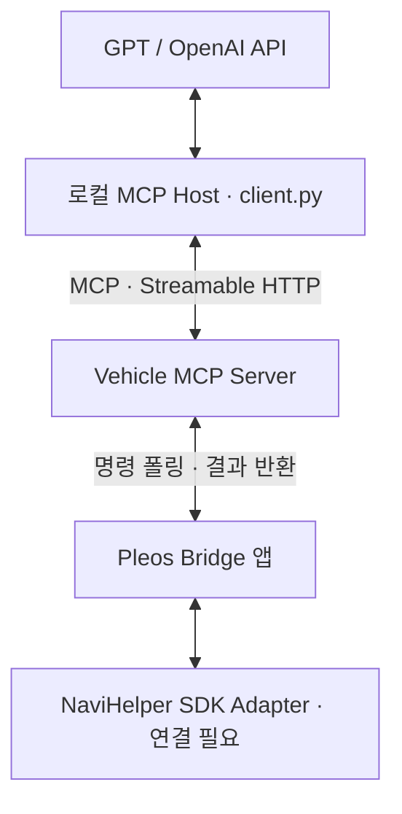

# Vehicle MCP PoC v0.1

2인 팀의 첫 기술 검증용 코드. 조회 도구 `get_navigation_info` 하나만 제공한다.
**실제 MCP 서버·클라이언트와 Bridge 통신은 구현되어 있다. Pleos SDK Adapter와 완성된 Android 앱은 아직 없다.**

## 구조



GPT를 사용하지 않아도 MCP 도구 검색·호출을 테스트할 수 있다.
선택 실행인 GPT 경로는 로컬 Host가 MCP 도구를 발견해 OpenAI Function Calling으로 제공하고,
GPT의 호출 요청을 실제 MCP 요청으로 전달한다. **OpenAI 서버가 localhost에 직접 접속하는 구조가 아니다.**
ChatGPT 웹앱의 Remote MCP 커넥터 연결·OAuth·공개 배포는 이번 버전에 포함되지 않는다.

## 1. Windows에서 시작하기

Python 3.11 이상이 필요하다. ZIP을 풀고 `vehicle-mcp` 폴더에서 PowerShell을 연다.
가상환경 활성화 없이 실행하는 명령이므로 PowerShell 실행 정책 변경은 필요 없다.

```powershell
py -3 -m venv .venv
.\.venv\Scripts\python.exe -m pip install -e ".[test,gpt]"
.\.venv\Scripts\python.exe scripts/init_env.py
```

`init_env.py`는 임의의 MCP/Bridge 토큰을 서로 다르게 생성해 `.env`에 저장한다.
`.env`는 덮어쓰지 않는다. 두 토큰과 OpenAI 키는 Git에 올리지 않는다.

macOS/Linux에서는 `python3 -m venv .venv` 후 아래 명령의 Python 경로를
`.venv/bin/python`으로 바꾸면 된다.

## 2. MCP만 실행하기 — API 키 불필요

첫 번째 터미널:

```powershell
.\.venv\Scripts\python.exe -m vehicle_mcp.server
```

같은 폴더의 두 번째 터미널:

```powershell
.\.venv\Scripts\python.exe -m vehicle_mcp.client
```

도구 이름과 다음 값을 포함한 MCP 결과가 출력되면 성공이다.

```json
{
  "status": "ok",
  "source": "mock",
  "destination_name": "서울역 (시뮬레이션)",
  "remaining_distance_m": 12300,
  "remaining_duration_s": 1080
}
```

실제 응답에는 UTC 조회 시각 `observed_at`도 포함된다.
이 숫자는 **고정 테스트 데이터**이며 Pleos 조회 성공의 증거가 아니다.

## 3. GPT 연결 — 선택, API 사용 요금 발생 가능

`.env`에 본인이 사용할 API 키와 Function Calling을 지원하는 접근 가능한 모델 ID를 넣는다.
ChatGPT 구독과 API 사용은 별개다. 키는 채팅이나 Android 앱에 붙여넣지 않는다.

```dotenv
OPENAI_API_KEY=본인의_API_키
OPENAI_MODEL=본인_계정에서_사용할_모델_ID
```

서버를 실행한 상태에서:

```powershell
.\.venv\Scripts\python.exe -m vehicle_mcp.client --ask "현재 목적지까지 얼마나 남았어?"
```

예상 응답은 ‘시뮬레이션 데이터 기준 약 12.3km, 18분 남았습니다’와 같은 내용이다.
실제 문구와 도구 선택은 모델에 따라 다르다. 모의 데이터임을 밝히는지, 1,080초를 18분으로
변환하는지 확인한다. 서버는 키를 사용하지 않고 로컬 Host만 OpenAI API를 호출한다.
목적지명·남은 거리·시간은 이 옵션 사용 시 OpenAI에 전달된다. 첫 검증에는 모의 데이터만 사용한다.

현재 제작 환경에서는 API 키 없이 코드와 모의 응답 테스트만 수행했다.
**실제 GPT API 호출 성공을 검증한 버전은 아니다.**

## 4. Bridge 통신 검증 — Pleos 없이 가능

서버를 종료하고 `.env`의 `VEHICLE_MODE=mock`을 `VEHICLE_MODE=bridge`로 바꾼다.
서버를 다시 시작한 다음 별도 터미널에서:

```powershell
.\.venv\Scripts\python.exe scripts/mock_bridge.py
```

세 번째 터미널에서 MCP 클라이언트를 실행한다. 결과의 `source`는 `mock_bridge`여야 한다.
이 경우 MCP → 명령 대기열 → Bridge → 결과 반환 경로를 거친다.
시뮬레이터를 실행하지 않았다면 `bridge_offline`, 폴링 후 결과가 없으면 `timeout`을 반환한다.
실패해도 고정 숫자로 대체하지 않는다.

## 5. Pleos 실제 연결 — 다음 작업

`android/VehicleBridgeLoop.kt`는 기존 Pleos 앱에 넣을 **통신 템플릿**이다.
OkHttp와 kotlinx-coroutines-android 의존성이 있는 Android 프로젝트가 필요하다.
완성 APK, Gradle 프로젝트, SDK Adapter는 포함되어 있지 않으며 이 Kotlin 파일은 아직 빌드 검증하지 않았다.

1. Pleos 앱에서 공식 NaviHelper SDK의 초기화·권한·이벤트 등록을 먼저 검증한다.
2. 목적지, 남은 거리/시간이 어떤 콜백으로 어떤 단위로 제공되는지 현재 SDK에서 확인한다.
3. `NavigationProvider.readSnapshot()`에 실제 콜백 기반 조회를 연결한다.
4. 아래 응답 규격에 맞춰 결과를 반환한다. `observed_at`은 HTTP 송신 시각이 아니라 데이터 조회 시각이다.
5. 앱이 화면에 실행 중인 동안만 Bridge Loop를 실행한다. 장시간 백그라운드 실행은 범위 밖이다.

PC에서 Android Debug Bridge로 로컬 포트를 연결:

```powershell
adb reverse tcp:8000 tcp:8000
```

템플릿의 `baseUrl`은 `http://127.0.0.1:8000`, 토큰은 로컬 `.env`의 `BRIDGE_TOKEN`을
개발용 설정으로 전달한다. 토큰을 소스에 하드코딩하지 않는다. 여러 기기 연결 시 `adb -s <serial>`을 쓴다.
Android INTERNET 권한과 localhost용 **debug 빌드 한정** cleartext 허용 설정이 필요하다.
예를 들어 `src/debug/res/xml/local_network_security.xml`:

```xml
<?xml version="1.0" encoding="utf-8"?>
<network-security-config>
  <domain-config cleartextTrafficPermitted="true">
    <domain>127.0.0.1</domain>
  </domain-config>
</network-security-config>
```

debug manifest의 application에 `android:networkSecurityConfig="@xml/local_network_security"`를
연결한다. release 설정으로 복사하지 않는다.

### Bridge 응답 규격

서버는 단일 차량만 지원한다. Bridge는 `Authorization: Bearer <BRIDGE_TOKEN>`으로 요청한다.
실제 토큰을 URL 쿼리에 넣지 않는다.

`GET /bridge/commands`는 최대 10초 대기한다. 명령이 없으면 HTTP 204.

```json
{
  "command_id": "서버가_발급한_UUID",
  "tool": "get_navigation_info",
  "arguments": {}
}
```

실제 SDK 조회 완료 후 `POST /bridge/results`:

```json
{
  "command_id": "GET에서_받은_UUID",
  "result": {
    "source": "pleos_sdk",
    "status": "ok",
    "observed_at": "2026-10-27T01:00:00Z",
    "destination_name": "서울역",
    "remaining_distance_m": 12300,
    "remaining_duration_s": 1080
  }
}
```

위 시간은 형식 예시다. 실제 호출 시 최신 시각과 실제 값을 사용해야 한다.
목적지가 없으면 `status=no_destination`, 미지원이면 `unsupported`, 조회 실패면 `sdk_error`로
반환하고 목적지·거리·시간 필드는 생략한다. 아직 구현되지 않은 어댑터는 `unsupported`를 반환한다.
`source=pleos_sdk`는 Bridge가 보고하는 값이며 하드웨어 증명/검증 기능은 없다.
목적지명은 명령이 아닌 데이터로 취급하며 SDK 원문 오류는 AI에 전달하지 않는다.
30초보다 오래됐거나 서버보다 5초 넘게 미래인 데이터는 `stale_data`로 처리한다.
PC와 에뮬레이터의 시계를 맞춘다.

## 6. 테스트

```powershell
.\.venv\Scripts\python.exe -m pytest -q
```

실제 localhost HTTP 서버와 공식 MCP 클라이언트로 초기화·도구 검색·호출을 검증한다.
별도 Bridge 시뮬레이터가 명령 ID에 맞는 응답을 보내는지, 역순 응답이 서로 섞이지 않는지,
인증·목적지 없음·미지원·SDK 오류·오래된 데이터·잘못된 값·타임아웃을 확인한다.

## 한계와 다음 단계

- 지금은 Python MCP SDK v1 유지보수 계열 `1.30.0`을 고정해 사용한다. v2 전환은 별도 검증한다.
- 로컬 단일 차량 개발용, 메모리 대기열, worker 1개. 재시작하면 진행 중 명령은 사라진다.
- MCP 토큰과 Bridge 토큰을 분리했지만 OAuth·다중 사용자·차량 소유권 검증은 아직 없다.
- 서버는 127.0.0.1에서만 수신한다. 외부 공개·터널·배포는 이 버전으로 진행하지 않는다.
- 물리 제어·경로 변경·다른 앱 UI 조작 도구는 없다.
- 실제 Pleos SDK/에뮬레이터 및 GPT 라이브 응답은 사용자의 환경에서 추가 검증해야 한다.

## 근거 문서

- MCP SDK v1: https://py.sdk.modelcontextprotocol.io/v1/
- OpenAI Function Calling: https://developers.openai.com/api/docs/guides/function-calling
- Pleos SDK: https://document.pleos.ai/docs/pleos-only/connect-sdk-pleos/

정확한 Pleos 어댑터 코드는 실제 사용하는 SDK 버전과 콜백 응답을 확인한 뒤 작성한다.
존재 여부를 확인하지 않은 `getRemainingTime()` 등의 SDK 함수를 만들어 넣지 않았다.
