# Vehicle MCP 0.2.1 — 팀 인수인계 및 최신 검증 보고서

작성 기준: 2026-10-28, 한국 시간  
Android 버전: `0.2.1-avd` / `versionCode=2`  
프로젝트: `FirstF1ame/HyundaiMCP`

## 1. 팀에 먼저 공유할 현재 결론

**Pleos AVD의 내장 내비게이션에서 목적지·거리·시간을 SDK로 읽어 Android Bridge와 Python MCP를 거쳐 PC에 반환하는 경로를 확인했다.**

**OpenAI API 요청·오류 응답 수신 경로도 확인했다. 다만 API 크레딧 부족으로 모델 실행이 거부되어 GPT가 MCP 도구를 호출하고 자연어로 답하는 전체 경로는 아직 검증하지 못했다.**

현재 구현은 **내장 내비게이션을 수정한 앱이 아니라, 공식 NaviHelper SDK를 통해 조회하는 별도 Android 앱**이다. 내장 앱의 소스 프로젝트는 확보하지 못했고, 원본 수정·재배포 가능 여부도 미확정이다.

| 구간/항목 | 현재 상태 | 근거 |
| --- | --- | --- |
| Pleos 내장 내비게이션 설치·경로 안내 | 확인 | 사용자 AVD 화면 및 앱 패키지 조회 |
| NaviHelper 서비스 연결 | 확인 | 사용자 테스트 앱 화면 |
| 목적지·거리·시간 콜백 수신 | 확인 | 0.2.1 앱의 `source=pleos_sdk`, `status=ok` 화면 |
| Android Bridge → Python 서버 → MCP 클라이언트 | 확인 | PC에서 두 번 수신한 정상 MCP 결과 |
| Python Host → OpenAI API 요청·응답 | 확인 | HTTP 429 / `credit_balance_exhausted` |
| 실제 GPT 응답 생성 | 미확인 | 크레딧 부족으로 실행 거부 |
| GPT가 MCP를 실제 호출한 뒤 최종 답변 | 미확인 | OpenAI 요청이 크레딧 오류로 중단; 실제 도구 호출 trace 없음 |
| Python 모의 Bridge 성능 | 확인 | 16개 워커·1,000회 모두 성공한 별도 JSON |
| 실차·운영 환경·장시간 안정성 | 미검증 | 이번 AVD/로컬 검사 범위 밖 |
| 내장 내비게이션 원본 수정 | 미확정 | 설치된 앱만 보유; 공식 소스·수정 권한 미확인 |

이 문서의 **실제 SDK**는 Pleos AVD에서 공식 SDK 호출을 수행했다는 뜻이다. 물리 차량에서 측정한 실제 주행 데이터라는 뜻은 아니다.

## 2. 문서의 근거와 읽는 방법

### 2.1 근거 자료

| 자료 | 설명 |
| --- | --- |
| [SDK–MCP 성공 증거 요약](docs/evidence/pleos-mcp-success-20261028.json) | 사용자가 공유한 두 차례 PowerShell 결과를 정규화. 목적지명은 비식별화 |
| [OpenAI 오류 증거 요약](docs/evidence/openai-quota-error-20261028.json) | 첨부 로그에서 HTTP 상태·API 오류 유형·코드만 추출 |
| [원본 모의 성능 결과](docs/benchmarks/bridge-c16-1000-r1.json) | 사용자가 제출한 1,000회 측정 JSON을 원본 그대로 보존 |
| [이전 상세 보고서](MCP_VALIDATION_REPORT.md) | 이전 성능 비교·파일별 전체 역할·테스트 세부 목록 |
| `VALIDATION.md` | Python/Android 자동 검사와 버전별 기록 |
| `android/README.md` | Android Studio에서 빌드·실행하는 절차 |

성공·오류 증거 요약 파일은 **원본 로그의 완전한 복제본이 아니다.** 실제 목적지명·비밀값·로컬 사용자 경로는 공유 자료에서 제외했다. API 키와 Bridge/MCP 토큰은 이 문서와 증거 파일에 저장하지 않는다.

### 2.2 검사 이력과 최신 사용자 확인의 구분

- Android 18개·Python 12개 통과는 앞선 개발환경에서 실행한 자동 검사 기록이다.
- SDK와 MCP 실제 왕복 성공은 **사용자 PC·AVD에서 공유한 출력**을 근거로 한다.
- OpenAI 상태는 사용자가 제출한 실제 API 오류를 근거로 한다.
- 이 문서 작성만을 위해 실제 유료 API를 다시 호출하거나 모든 테스트를 재실행하지 않았다.
- 사용자 SDK 출력에는 코드 해시나 설치 APK 해시가 없어 실행 환경을 특정 Git 커밋과 암호학적으로 연결할 수는 없다.

## 3. 최신 구조와 확인한 경로

```mermaid
flowchart LR
    N["내장 내비게이션 · Pleos AVD"] <-->|"Navi Service / 공식 SDK"| P["PleosNavigationProvider"]
    P <--> Q["NavigationQuery · 목적지 콜백 대기"]
    Q <--> A["VehicleBridgeLoop · Android"]
    A <-->|"명령 GET / 결과 POST"| S["FastAPI + Broker"]
    S <-->|"공식 MCP · Streamable HTTP"| H["Python MCP Client / Host"]
    H -.->|"Responses API 요청 / 429 수신 확인"| O["OpenAI API"]
```



실선 구간은 사용자 SDK–MCP 왕복 확인에 포함된다. OpenAI 구간은 요청과 오류 수신까지 확인했으며 모델 응답 생성은 미확인이다.

GPT 연동의 목표 흐름은 다음과 같다.

```text
사용자 질문
→ 로컬 Python Host가 OpenAI에 질문과 도구 정의 전송
→ GPT가 get_navigation_info 함수 호출 요청 생성 [미확인]
→ Host가 MCP 도구 호출
→ 서버가 Android Bridge에 명령 전달
→ Android가 NaviHelper로 목적지·거리·시간 조회
→ MCP 결과를 Host가 GPT에 반환 [GPT 경유 실행은 미확인]
→ GPT가 자연어 답변 생성 [미확인]
```

OpenAI가 PC의 localhost에 직접 접속하지 않는다. **로컬 Host가 OpenAI API와 로컬 MCP 양쪽을 중계**한다. Android 앱에도 OpenAI API 키를 넣지 않는다.

## 4. 해결한 환경 문제

### 4.1 일반 Google Automotive 이미지와 Pleos 이미지 구분

초기 AVD에서는 다음이 관측됐다.

- Google Automotive 계열 빌드 식별자.
- `com.android.car.mapsplaceholder`만 지도 앱으로 확인.
- Virtual Console 연결 시 `ERR_EMPTY_RESPONSE`.
- ADB 포워딩은 등록됐지만 AVD의 8088 서비스 응답은 확인되지 않음.

이후 사용자는 Pleos 이미지로 다시 설정하고 내장 내비게이션을 확인했다. **API 레벨만 34로 맞추는 것으로 충분하지 않고 Pleos 시스템 이미지를 선택해야 한다.**

확인한 Windows용 공식 이미지:

```text
Pleos Connect v2.1.0 APIs Intel x86_64 Atom System Image
system-images;android-34;pleos_car_emulator;x86_64
```

### 4.2 확인한 내장 앱

사용자 명령:

```powershell
& $adbPath shell cmd package query-activities --brief -a android.intent.action.MAIN -c android.intent.category.APP_MAPS
```

확인된 실행 대상:

```text
ai.umos.maps.android.navigation.app/.MainActivity
```

이 식별자는 설치된 내비게이션의 실행 대상을 알려준다. **소스 공개, 수정 허용, 외부 API의 모든 기능 지원을 증명하지는 않는다.** 공개 검색에서 이 패키지를 참조하는 별도 앱은 찾았지만 내장 앱 자체의 공식 소스 프로젝트는 확인하지 못했다.

### 4.3 포트와 방향

| 용도 | 명령 | 방향 |
| --- | --- | --- |
| Android Bridge가 PC 서버 호출 | `adb reverse tcp:8000 tcp:8000` | AVD의 8000 → PC의 8000 |
| PC 브라우저가 Virtual Console 접속 | `adb forward tcp:18088 tcp:8088` | PC의 18088 → AVD의 8088 |

PC의 8088 bind는 Windows 오류 10013으로 거부되어 Console의 PC 포트를 18088로 변경했다.

```text
Virtual Console의 PC 브라우저 주소: http://127.0.0.1:18088/
```

포워딩 등록은 내부 서비스 정상 실행을 보장하지 않는다. 대화에서 Console의 차량 상태 변경까지 성공했다는 별도 결과는 공유되지 않았으므로, **Virtual Console의 모든 기능 검증 완료로 기록하지 않는다.** Console은 내비게이션 앱이나 Python Bridge를 대신하는 도구도 아니다.

## 5. 0.2.0 → 0.2.1 코드 변경

### 5.1 문제: 경로 안내 중인데 `no_destination`

기존 앱은 다음 순서로 처리했다.

```text
getRouteStateInfo()
→ isRouting 확인
→ false이면 no_destination 반환
→ getDestinationInfo()는 호출하지 않음
```

사용자의 내비게이션에는 목적지와 거리·시간, 길 안내가 표시됐지만 테스트 앱은 `no_destination`을 반환했다. 단일 상태값으로 목적지 부재를 확정하고 **목적지 API 호출 자체를 생략한 앱의 판정**이 문제였다.

SDK가 그 상태값을 보고한 정확한 런타임 이유는 별도 조사 대상이다. 이 수정으로 SDK의 `isRouting` 의미를 새로 정의하거나, 항상 경로 탐색 중 여부라는 의미라고 단정하지 않는다.

### 5.2 수정: 목적지 콜백을 직접 확인

```text
getDestinationInfo() 직접 요청
→ onDestinationInfo() 대기
→ 유효한 응답이면 ok

getRouteStateInfo()는 진단용으로 별도 요청
→ isRouting/naviMode는 화면 기록
→ false라도 목적지 응답 대기를 중단하지 않음
```

| 변경 | 이전 | 0.2.1 |
| --- | --- | --- |
| 목적지 조회 조건 | isRouting이 true여야 호출 | 연결 상태가 정상이면 직접 호출 |
| false 경로 상태 | 즉시 `no_destination` | 진단으로 표시하고 목적지 응답 대기 |
| 목적지 미응답 | 경로 상태에서 조기 종료될 수 있음 | 6초 대기 후 `sdk_error` |
| `no_destination` | isRouting=false로 생성 | 현재 조회 중 명시적인 경로 취소 이벤트 수신 시 생성 |
| SDK 진단 | 단일 상태 문구 | 최근 이벤트 최대 8개 표시 |
| 조회 상태 처리 | SDK Provider 안에 혼재 | `NavigationQuery`로 분리 |
| Android 테스트 | 6개 | 기존 6개 + 회귀 12개 = 18개 |

미응답은 **조회 실패/불명확**이며, 목적지가 없다는 증거와 다르다. 모의 값이나 이전 목적지 값을 대신 반환하지 않는다.

### 5.3 새 핵심 클래스: `NavigationQuery.kt`

경로: `android/app/src/main/java/example/vehiclemcp/NavigationQuery.kt`

| 구성 요소 | 역할 |
| --- | --- |
| `requestDestination` | SDK 목적지 요청 함수를 주입받음 |
| `requestRouteState` | SDK 진단 요청 함수를 주입받음 |
| `read()` | 직렬화 → 요청 → 콜백 대기 → 결과/오류 반환 → 대기 상태 정리 |
| `Mutex` | 동시에 들어온 조회를 한 번에 하나씩 처리 |
| `CompletableDeferred` | 콜백 결과를 suspend 함수의 반환값에 연결 |
| `withTimeout(6000)` | 목적지 콜백 대기 제한 |
| `onDestination()` | 현재 대기 중인 조회에 목적지 결과 전달 |
| `onRouteState()` | isRouting/naviMode를 진단으로 표시; 결과 gate로 사용하지 않음 |
| `onRouteCancelled()` | 현재 대기를 `no_destination`으로 완료 |
| `onDestinationChanged()` | 조회 중 변경 시 `sdk_error`; 혼합된 값 대신 재시도 요구 |
| `onError()` | SDK 오류 코드를 기록하고 `sdk_error`로 완료 |
| `close()` | 현재 대기 취소 |

SDK·Android 의존성을 상태 머신에서 분리했기 때문에, 실제 서비스 없이 콜백 순서를 제어하는 회귀 테스트가 가능해졌다. SDK 콜백과 조회는 Provider가 Main 디스패처로 모은다.

### 5.4 Provider와 화면 변경

- `PleosNavigationProvider.kt`: SDK 연결·리스너·메인 디스패처와 `NavigationQuery`를 연결하는 어댑터.
- `onDestinationInfo()`: SDK `name`, `remainDistance`, `remainTime`을 결과 모델로 변환.
- `onNavigationStatus()`: 상태를 진단으로 표시하며 단독으로 목적지 부재를 판단하지 않음.
- `MainActivity.kt`: 최근 SDK 이벤트를 최대 8개 보존해 경로 상태와 실제 콜백을 함께 확인.
- `android/app/build.gradle.kts`: `versionName=0.2.1-avd`, `versionCode=2`; coroutine-test 의존성 추가.

SDK 오류 코드와 경로 상태는 진단에 남기지만 토큰·좌표를 이벤트 메시지에 넣지 않는다. 결과 JSON에는 목적지명이 표시되므로 화면 공유 시 실제 위치 정보도 함께 확인해야 한다.

## 6. 실제 SDK–MCP 왕복 성공 근거

PC에서 다음 명령을 두 번 실행했다.

```powershell
.\.venv\Scripts\python.exe -m vehicle_mcp.client
```

두 출력 모두 다음을 만족했다.

| 항목 | 값 |
| --- | --- |
| 도구 검색 | `MCP tools: get_navigation_info` |
| MCP 오류 | `isError: false` |
| 업무 상태 | `status: ok` |
| 출처 | `source: pleos_sdk` |
| 목적지명 | 사용자 설정 목적지 수신; 공유본에서는 비식별화 |
| 남은 거리 | 23,000m = 23km |
| 남은 시간 | 1,860초 = 31분 |

| 호출 | `observed_at` 원본 UTC | 한국 시간 |
| --- | --- | --- |
| 1 | `2026-10-28T11:51:23.114557Z` | 2026-10-28 20:51:23.114557 KST |
| 2 | `2026-10-28T11:53:39.041717Z` | 2026-10-28 20:53:39.041717 KST |

공유용 응답 예시:

```json
{
  "source": "pleos_sdk",
  "status": "ok",
  "observed_at": "2026-10-28T11:53:39.041717Z",
  "destination_name": "테스트 목적지 (공유용 비식별화)",
  "remaining_distance_m": 23000,
  "remaining_duration_s": 1860
}
```

위 예시는 실제 사용자 출력에서 목적지명만 바꾼 요약이다. 원본의 `content` 텍스트와 `structuredContent`에는 같은 결과가 들어 있었고, PC에서는 구조화된 필드를 직접 사용할 수 있다.

두 번의 시각 갱신은 이 앱의 **콜백 수신 시각이 갱신됐음**을 보여 준다. SDK 내부의 원본 데이터 관측 시각이나 실제 차량 센서의 최신성까지 증명하지는 않는다. 내비게이션의 화면 표시는 km·분으로 반올림될 수 있고, 화면 캡처 시점과 조회 시점도 다르므로 단순 숫자 완전 일치만으로 판정하지 않는다.

`source=pleos_sdk`는 데이터 경로를 보고하는 필드이지 하드웨어 출처 증명은 아니다. 이번에는 사용자 AVD의 SDK 화면, Bridge 결과 전송, PC의 MCP 결과를 함께 확인한 것이 근거다.

## 7. OpenAI API 검증에서 확인한 사실

실행한 경로:

```powershell
.\.venv\Scripts\python.exe -m vehicle_mcp.client --ask "현재 목적지까지 남은 거리와 시간을 도구로 조회해서 알려줘."
```

실제 로그의 최종 원인:

```text
openai.RateLimitError
HTTP 429
error.type = insufficient_quota
error.code = credit_balance_exhausted
message = You have no credits remaining.
```

### 7.1 확인된 것

- Python Host가 `ai.responses.create()`를 호출했다.
- OpenAI API로부터 구조화된 오류 응답을 받았다.
- 이번 실행의 차단 사유는 크레딧 부족이었다.
- 외부의 `ExceptionGroup / TaskGroup` 문구는 비동기 컨텍스트를 정리하며 API 예외가 감싸져 보이는 형태다. 이 로그에서 원인으로 확인된 것은 내부의 OpenAI 잔액 오류다.

### 7.2 아직 확인되지 않은 것

- 선택한 모델 ID의 실제 실행 가능 여부와 모델 응답 생성.
- GPT가 `get_navigation_info` 호출 요청을 생성하는지.
- GPT의 요청으로 SDK–MCP 호출을 수행하는지.
- 도구 결과를 GPT에 반환한 뒤 목적지·거리·시간을 올바르게 답하는지.
- 실제 모델이 오류 상태에서 숫자를 추측하지 않고 단위를 올바르게 변환하는지.

일반 MCP 직접 호출이 성공했다는 사실과 GPT가 도구를 사용했다는 사실은 구분한다. **제출된 로그에는 실제 function call이나 최종 모델 답변의 성공 증거가 없다.** 오류 로그만으로 어느 반복의 OpenAI 요청에서 실패했는지까지 확정할 수는 없으므로, GPT 도구 호출 여부는 미확인으로 남긴다.

보고서에 사용할 표현:

> OpenAI API 요청과 오류 응답 수신 경로는 확인했다. 다만 API 크레딧 부족으로 모델 실행이 거부되어 실제 GPT 도구 호출과 최종 답변까지의 연동은 미검증이다.

결제 반영 전 같은 요청을 계속 재시도하거나 새 키를 만드는 것으로 잔액 문제가 해결되지는 않는다. API 키가 속한 조직/프로젝트의 결제·크레딧을 확인해야 한다. ChatGPT 구독과 API 사용 요금은 별개다.

## 8. 파일별 책임과 팀 코드 리뷰 포인트

### 8.1 Python

| 파일 | 주요 책임 | 리뷰할 부분 |
| --- | --- | --- |
| `vehicle_mcp/server.py` | FastMCP 도구 등록, FastAPI 라우트, 인증 래퍼, Uvicorn 실행 | mock/bridge 분기, 도구가 조회 전용인지, HTTP/업무 상태 구분 |
| `vehicle_mcp/broker.py` | UUID별 Future와 명령 대기열, 응답 연결, 신선도·용량 제한 | 응답이 역순이어도 매칭되는지, 완료/취소/시간 초과 정리 |
| `vehicle_mcp/models.py` | Bridge 본문과 목적지 응답 검증 | 정상·오류 응답의 필드 규칙, 단위, strict 정수, extra 필드 거부 |
| `vehicle_mcp/config.py` | 환경변수/.env 로딩과 Settings 검증 | 토큰 최소 길이/중복, 모드, 명령 대기 시간 |
| `vehicle_mcp/client.py` | 공식 SDK 연결, 직접 probe, 선택적 GPT Host | API 키가 로컬 Host에만 있는지, 허용 도구·인자 검사·call_id 매칭 |
| `vehicle_mcp/__init__.py` | Python 패키지 설명 | 실행 진입점은 server/client 모듈 |
| `scripts/init_env.py` | 난수 MCP/Bridge 토큰 최초 생성 | 기존 .env를 덮어쓰지 않음 |
| `scripts/mock_bridge.py` | 별도 Python 모의 응답 전송 | 실제 AVD 검사 중에는 실행하지 않음 |
| `scripts/benchmark_mcp.py` | 워커별 초기화/워밍업/부하·응답 검사·보고서 생성 | 고정 mock 데이터만 허용하므로 실제 SDK에 사용하지 않음 |
| `tests/test_mcp.py` | 실제 로컬 HTTP·MCP 통합 테스트 | 인증, 상태·신선도, 오류, 중복, 역순·동시성 |
| `tests/test_gpt_host.py` | 가짜 모델과 실제 로컬 MCP의 Host 경계 검사 | 실제 모델 응답 품질이나 API 결제를 검증하는 테스트가 아님 |

### 8.2 Android

Java/Kotlin 코드의 공통 디렉터리: `android/app/src/main/java/example/vehiclemcp/`

| 파일 | 주요 책임 | 리뷰할 부분 |
| --- | --- | --- |
| `MainActivity.kt` | 테스트 UI, SDK 이벤트 목록, 수동 조회, Bridge 시작/중지 | onStart에서 연결, onStop에서 작업 취소·SDK 해제·토큰 삭제 |
| `PleosNavigationProvider.kt` | 공식 NaviHelper 연결·리스너와 조회 상태 머신의 접점 | SDK 콜백을 Main 디스패처로 전달, 결과 필드 매핑 |
| `NavigationQuery.kt` | 비동기 목적지 조회의 상태 머신 | false 경로 상태가 조회를 막지 않는지, 취소·시간 초과·동시성 |
| `NavigationResult.kt` | SDK 결과를 Python 계약에 맞는 JSON으로 변환 | 성공 값 검증, 오류이면 목적지·거리·시간 제외 |
| `VehicleBridgeLoop.kt` | 명령 GET, Provider 조회, 결과 POST 반복 | Bearer 토큰, command_id, 401/409/재시도/취소 |
| `NavigationProvider` 인터페이스 | SDK 구현과 전송 루프 분리 | `VehicleBridgeLoop.kt`에 정의. 테스트용 Provider를 주입 가능 |

`MainActivity`가 화면에서 사라지면 Bridge가 중지되고 토큰도 지워진다. 이 앱은 현재 장시간 백그라운드 서비스가 아니다. 내비게이션 목적지를 먼저 설정한 뒤 테스트 앱으로 돌아와 토큰을 입력한다.

### 8.3 실행 설정·리소스·문서

| 파일/영역 | 역할 |
| --- | --- |
| `pyproject.toml` | Python 필수 의존성, 선택적 gpt/test 의존성, pytest 설정 |
| `requirements-lock.txt` | Python 직접·간접 의존성 고정 |
| `.gitignore` | .env, 가상환경, 캐시, PC별 Android 설정과 빌드 출력 제외 |
| `android/settings.gradle.kts` | app 모듈 및 Google/Maven Central/Pleos 저장소 |
| `android/build.gradle.kts` | AGP 8.7.3, Kotlin 1.9.25 |
| `android/gradle.properties` | Gradle 메모리·worker 수·AndroidX |
| `android/gradlew*`, `gradle/wrapper/*` | Gradle 8.9 실행 및 배포 SHA-256 검증 |
| `android/app/build.gradle.kts` | minSdk 28, compile/targetSdk 34, SDK·Coroutines·OkHttp·테스트 의존성 |
| 메인 Manifest | INTERNET/NAVI_ROUTE 권한, Activity, Navi Service 패키지 가시성, 백업 정책 |
| debug Manifest 및 `local_network_security.xml` | debug의 127.0.0.1만 평문 HTTP 허용 |
| `strings.xml`, `ic_vehicle.xml` | UI 문구 및 아이콘 |
| `backup_rules.xml`, `data_extraction_rules.xml` | 구/신 Android의 백업·전송 제외 설정 |
| `android/app/src/test/...` | 결과 변환 4개, Bridge 전송 2개, 조회 회귀 12개 |
| `.env` | 토큰과 선택적 OpenAI 설정. 공유·Git 포함 대상 아님 |
| `android/local.properties` | Android SDK의 PC별 경로. 공유 대상 아님 |
| `TEAM_HANDOFF_0.2.1.md` | 최신 사용자 확인까지 반영한 팀 공유 기준 문서 |
| `MCP_VALIDATION_REPORT.md` | 이전 측정·전체 코드 설명의 상세 자료 |
| `docs/evidence/*` | 비식별화한 SDK 왕복·API 오류 근거 요약 |

### 8.4 요청 ID와 비동기 처리의 경계

- Python Broker의 `command_id`는 각 MCP 요청과 Bridge 결과를 연결하는 UUID다.
- Android는 받은 command_id를 결과 POST에 그대로 넣는다.
- SDK 콜백에는 동일한 요청 ID가 없으므로, `NavigationQuery`는 SDK 조회를 직렬화한다.
- 직렬화와 대기 종료 후 정리로 혼선을 줄이지만, **매우 늦은 SDK 콜백이 새 요청 도중 도착하면 어느 요청의 응답인지 완전히 식별할 수는 없다.**
- `observed_at`은 SDK 원본 관측 시각이 아니라 콜백 수신 시각이다.
- 모의 부하 JSON의 `samples.request`는 측정용 순번이며 Broker의 command_id가 아니다.

## 9. 서버 계약과 실패 상태

| 경로 | 인증 | 기능 |
| --- | --- | --- |
| `/mcp` | MCP_TOKEN | 공식 MCP의 초기화·도구 검색·호출 |
| `/health` | MCP_TOKEN | 서버 상태와 모드; SDK 정상 여부를 보장하지 않음 |
| `/bridge/commands` | BRIDGE_TOKEN | 명령 long polling, 없으면 204 |
| `/bridge/results` | BRIDGE_TOKEN | 응답 본문 검증 후 UUID 매칭; 수신 불가 시 409 |

`TokenGate`가 경로별 토큰을 구분하고 `hmac.compare_digest`로 비교한다. 로컬 개발용 인증이며 OAuth·다중 사용자·차량 소유권 확인을 구현한 것은 아니다.

| 항목 | 값/규칙 |
| --- | --- |
| 기본 서버 포트 | 8000, 127.0.0.1에 바인딩 |
| 명령 대기 | 기본 12초; 초과 시 `timeout` |
| poll 대기 | 최대 10초 |
| Bridge 오프라인 | 마지막 poll로부터 20초 초과 |
| pending/queue 한도 | 16; 초과 시 `busy` |
| 시각 검증 | 30초 초과 과거 또는 5초 초과 미래면 `stale_data` |
| Android 목적지 대기 | 6초, 미응답이면 `sdk_error` |
| Android HTTP | 연결 3초·읽기 12초·전체 호출 14초 |
| 목적지 필드 | 이름 최대 200자, 거리 m/시간 s의 음수 아닌 strict 정수 |
| 성공 응답 | 이름·거리·시간 모두 필요 |
| 실패 응답 | 목적지·거리·시간 값 제외 |

`busy`, `timeout`, `bridge_offline`, `stale_data`는 Broker의 업무 상태다. HTTP 401/409/422 및 MCP의 `isError`와는 다른 층이다.

현재 `probe()`는 MCP의 `isError`를 확인하지만 모든 업무 실패 상태를 프로세스 오류로 바꾸지는 않는다. 따라서 **종료 코드가 0인지뿐 아니라 `structuredContent.status`와 `source`를 확인**한다.

## 10. 자동 테스트와 수동 검증의 관계

### 10.1 Python 12개

| 범위 | 수 | 내용 |
| --- | ---: | --- |
| MCP 도구 검색·호출·미등록 도구 거부 | 1 | 공식 SDK와 실제 로컬 HTTP 서버 |
| 토큰 역할 분리·누락 | 1 | 인증 누락/교차 사용 401 |
| Bridge 오프라인 | 1 | 실패 시 mock 값으로 대체하지 않음 |
| Bridge 왕복 파라미터화 | 6 | 정상·목적지 없음·SDK 오류·미지원·과거/미래 데이터 및 중복 거부 |
| 잘못된 값·시간 초과 | 1 | 음수 남은 시간 422, 이후 timeout |
| 동시 요청 역순 결과 매칭 | 1 | 서로 다른 거리 111/222가 올바른 호출에 돌아감 |
| 가짜 GPT Host 검사 | 1 | 가짜 function call → 실제 로컬 MCP → 결과 반환 |

사용자 PC에서 선택 실행한 9개 결과는 `9 passed, 2 deselected in 7.94s`였다. 여기서 제외된 2개는 `test_mcp.py`의 도구 검색/인증 테스트다. GPT 테스트는 다른 파일에 있어 해당 선택 실행에 포함되지 않는다. 전체 Python 12개 통과 이력은 개발환경의 별도 실행 결과다.

### 10.2 Android 18개

| 클래스 | 수 | 내용 |
| --- | ---: | --- |
| `NavigationResultTest` | 4 | 필드·단위·시각 보존, 오류 값 제외, 잘못된 성공 응답 거부, 0 허용 |
| `VehicleBridgeLoopTest` | 2 | Bearer 헤더·명령 ID·결과 POST, 잘못된 서버 모드 안내 |
| `NavigationQueryTest` | 12 | 아래 회귀 시나리오 |

추가한 조회 회귀 12개:

1. isRouting=false여도 목적지 요청을 수행하고 유효 응답을 수락.
2. 경로 상태 콜백이 없어도 목적지 응답 수락.
3. 진단 요청 자체가 실패해도 목적지 응답 수락.
4. 목적지 미응답은 sdk_error이며 no_destination으로 추정하지 않음.
5. 현재 조회 중 명시적인 경로 취소는 값 없는 no_destination.
6. SDK 오류는 값 없는 sdk_error.
7. 조회 중 목적지 변경은 재조회 요구.
8. 조회 시작 전에 도착한 콜백을 새 데이터로 재사용하지 않음.
9. 동시 조회를 직렬화하고 서로 다른 결과를 유지.
10. 호출자 취소를 성공으로 바꾸지 않고 다음 조회 허용.
11. 권한 예외를 sdk_error로 처리.
12. Provider 종료 시 활성 조회 취소.

SDK 요청 ID가 없다는 제약 때문에 **새 조회가 진행 중일 때 도착한 이전 요청의 콜백까지 구분하는 테스트/보장은 아니다.** 테스트 8·10은 대기 요청이 없는 시점의 이벤트를 재사용하지 않는 범위를 확인한다.

### 10.3 빌드 검사와 실제 AVD

- APK 빌드, 서명 검증, Android Lint 오류·경고 0건을 확인했다.
- Android JVM 테스트는 실제 Navi Service가 아니라 fake callback과 MockWebServer를 사용한다.
- 이후 사용자의 AVD SDK–MCP 정상 출력으로 실제 서비스 왕복을 추가 확인했다.
- 이 결과를 실차, 장시간 백그라운드 실행, 모든 장애 상황의 성공으로 확장하지 않는다.

## 11. 기존 성능 결과를 해석하는 범위

원본: `docs/benchmarks/bridge-c16-1000-r1.json`

| 항목 | 값 |
| --- | ---: |
| 환경 | Windows / Python 3.13.5 / MCP 1.30.0 |
| 동시 워커 | 16 |
| 측정 호출 | 1,000회 |
| 성공률 | 100% |
| 측정 구간 | 3.264초 |
| 처리량 | 306.4회/초 |
| 평균 / p95 / p99 | 51.889 / 55.855 / 58.322ms |
| 최대 | 77.500ms |
| 별도 세션 초기화 평균 / 최대 | 2,272.040 / 4,302.215ms |

이 결과는 **Python의 `mock_bridge.py`를 사용한 모의 경로**다. Android·NaviHelper·실제 내비게이션·OpenAI API를 측정한 결과가 아니다. 각 세션 초기화·도구 검색·1회 워밍업을 마친 뒤 closed-loop 방식으로 측정했다.

새 SDK–MCP 출력은 정확한 지연 측정 자료가 아니므로 **실제 SDK 경로도 p95 55.855ms라고 기록하면 안 된다.** GPT의 응답 지연과 품질은 크레딧 문제로 아직 측정할 수 없었다.

## 12. 팀원이 재현하는 순서 — Windows

### 12.1 최신 소스와 APK 받기

- [0.2.1 전체 소스 ZIP](https://raw.githubusercontent.com/FirstF1ame/HyundaiMCP/avd-test-artifacts/HyundaiMCP-avd-0.2.1-source.zip)
- [0.2.1 APK](https://raw.githubusercontent.com/FirstF1ame/HyundaiMCP/avd-test-artifacts/vehicle-mcp-avd-0.2.1-debug.apk)

Android Studio에서는 ZIP 안의 **android 폴더**를 연다. Python 명령은 `pyproject.toml`과 `scripts`가 있는 **프로젝트 최상위 폴더**에서 실행한다.

### 12.2 Python 최초 준비

```powershell
py -3 -m venv .venv
.\.venv\Scripts\python.exe -m pip install -r requirements-lock.txt
.\.venv\Scripts\python.exe -m pip install --no-deps -e ".[test,gpt]"
if (-not (Test-Path .env)) { .\.venv\Scripts\python.exe scripts/init_env.py }
```

기존 `.env`가 있다면 재생성하지 않는다. `init_env.py`를 다시 실행했을 때의 FileExistsError는 덮어쓰기 방지 동작이다. 가상환경을 활성화하지 않는 실행 방법이므로 PowerShell 실행 정책 변경은 필요 없다.

### 12.3 AVD와 내비게이션 준비

1. 실제 Pleos Connect v2.1.0 / API 34 이미지를 Cold boot로 실행.
2. 내장 내비게이션의 초기 설정을 완료하고 테스트 목적지의 경로 안내 시작.
3. Vehicle MCP 0.2.1에서 연결 후 조회 버튼으로 `pleos_sdk/ok` 확인.
4. Android 앱이 foreground일 때만 SDK/Bridge가 유지되는 점 확인.

### 12.4 터미널 A — 서버

모의 `scripts/mock_bridge.py`와 성능 측정은 종료한다.

```powershell
$env:VEHICLE_MODE = "bridge"
.\.venv\Scripts\python.exe -m vehicle_mcp.server
```

### 12.5 터미널 B — 포트 연결 및 토큰 주입

```powershell
$adbPath = "$env:LOCALAPPDATA\Android\Sdk\platform-tools\adb.exe"
Test-Path $adbPath
& $adbPath devices
& $adbPath reverse tcp:8000 tcp:8000
```

Test-Path가 false면 Android Studio의 SDK Location에 맞춰 경로를 수정한다. AVD는 하나만 실행하거나 `-s <실제_SERIAL>`로 대상을 지정한다.

앱의 Bridge 토큰 입력란을 클릭하고 기존 내용을 비운 뒤, 아래 명령을 한 줄씩 실행한다. `PS ...>`나 `>>`는 복사하지 않는다.

```powershell
$tokenLine = Get-Content .env | Where-Object { $_ -match '^BRIDGE_TOKEN=' } | Select-Object -First 1
if (-not $tokenLine) { throw "BRIDGE_TOKEN이 없습니다." }
$bridgeToken = ($tokenLine -split '=', 2)[1].Trim()
if ($bridgeToken -notmatch '^[A-Za-z0-9_-]{32,}$') { throw "자동 생성 토큰 형식을 확인하세요." }
& $adbPath shell input text $bridgeToken
Remove-Variable bridgeToken, tokenLine
```

클립보드를 사용하지 않고 현재 포커스된 입력란에 입력하는 방식이다. 실제 값이 명령 기록이나 문서에 직접 쓰이지 않도록 `.env`에서 읽는다. 앱에서 **Bridge 시작**을 누르고 화면을 유지한다. 입력란이 화면에 보일 수 있으므로 캡처에서는 가린다.

### 12.6 PC MCP 직접 호출

```powershell
.\.venv\Scripts\python.exe -m vehicle_mcp.client
```

성공 기준은 `isError=false`, `source=pleos_sdk`, `status=ok`, 목적지·거리·시간 수신이다. JSON은 기본적으로 파일이 아니라 이 명령을 실행한 PowerShell에 출력된다.

필요하면 텍스트 파일로 저장:

```powershell
.\.venv\Scripts\python.exe -m vehicle_mcp.client | Tee-Object -FilePath .\mcp-result.txt
```

이 파일은 `MCP tools:` 등도 포함할 수 있으므로 JSON 전용 파일은 아니다. 공유 전 실제 목적지명 등을 확인한다.

### 12.7 GPT API — 결제 반영 후 별도 검사

PC의 `.env`에서 설정한다. Android 앱에는 입력하지 않는다.

```dotenv
OPENAI_API_KEY=본인의_API_키
OPENAI_MODEL=계정에서_사용가능하고_Responses와_Function_Calling을_지원하는_모델_ID
```

API 키가 속한 조직/프로젝트의 크레딧과 결제 상태를 먼저 확인한다. 정상 API 실행은 목적지·거리·시간을 OpenAI에 전달할 수 있으며 API 요금이 발생할 수 있다.

```powershell
.\.venv\Scripts\python.exe -m vehicle_mcp.client --ask "에뮬레이터의 내비게이션 도구를 실제 호출해서 현재 목적지와 남은 거리, 시간을 알려줘. 거리는 km, 시간은 분으로 설명해줘."
```

성공 판정은 모두 필요하다.

1. 실제 OpenAI 모델 응답 생성.
2. GPT 실행 시점에 Android의 새 명령 수신/결과 전송 발생.
3. 최종 답변이 당시 SDK 결과의 목적지·거리·시간과 부합.
4. 실패/목적지 없음 상태에서 임의 숫자를 만들지 않는지 별도 확인.

현재 코드는 모델에 도구 사용을 지시하지만 실제 function call을 강제하거나 상세 호출 trace를 저장하지는 않는다. **그럴듯한 답변만 나온 경우를 도구 연동 성공으로 판단하지 않는다.** 정밀한 감사 기록이 필요하면 후속 작업에서 tool-call 추적을 추가한다.

## 13. 주요 오류의 원인과 대응

| 증상 | 확인된 원인/해석 | 대응 |
| --- | --- | --- |
| PowerShell에서 adb를 찾지 못함 | PATH 미등록 또는 다른 SDK 경로 | adb.exe 전체 경로 사용 |
| `& $adbPath` BadExpression | 새 창에 변수 미설정 또는 잘못된 값 | 경로 변수 재설정·Test-Path |
| 명령에 `>> &` 포함 | 프롬프트까지 복사된 사례 | Ctrl+C 후 프롬프트 제외·한 줄씩 실행 |
| adb devices가 비어 있음 | ADB에 연결된 실행 기기 없음 | AVD 부팅·SDK 경로·ADB 상태 확인 |
| 8088 bind 오류 10013 | PC 측 해당 포트 바인딩 거부 | Console의 PC 포트를 18088로 변경 |
| 포워딩 등록 후 ERR_EMPTY_RESPONSE | 등록만으로 내부 서비스 정상 보장 안 됨 | Pleos 이미지·서비스·Cold boot 확인 |
| mapsplaceholder만 존재 | 실제 내장 지도 앱 확인 안 됨 | Google/Pleos 이미지 선택 확인 |
| 0.2.0에서 안내 중 no_destination | false 상태값에 의한 조기 종료 | 0.2.1 적용 후 목적지 콜백 직접 확인 |
| 0.2.1 목적지 콜백 미수신 | 목적지 부재 확정 불가 | sdk_error와 최근 SDK 이벤트로 진단 |
| SDK 연결은 되나 Bridge 401 | Bridge 토큰 불일치/역할 혼동 | MCP_TOKEN 대신 BRIDGE_TOKEN 사용 |
| `source=mock_bridge` | Python 시뮬레이터 경로 | 실제 SDK 검사에서는 시뮬레이터 종료 |
| OpenAI 429 / credit_balance_exhausted | API 크레딧 소진 | 해당 조직/프로젝트의 결제·잔액 확인 |
| 큰 ExceptionGroup traceback | 내부 예외가 비동기 컨텍스트에서 감싸짐 | 최하위 오류 유형·코드를 확인 |

각 오류의 일반 원인은 환경별로 다를 수 있다. 표는 이번 세션에서 관측한 현상과 다음 확인 지점을 정리한 것이다.

## 14. 내장 앱 수정 가능성과 부가기능 개발 범위

현재 확보한 것은 내장 앱의 설치본뿐이다. APK가 실행되고 SDK가 연결된다는 사실은 원본 소스를 Android Studio로 가져와 수정할 수 있다는 뜻이 아니다.

| 작업 | 현재 판단 |
| --- | --- |
| 내장 앱 UI/내부 로직 직접 수정 | 공식 소스·라이선스·빌드/서명 조건 미확인 |
| 우리 Vehicle MCP 앱의 화면/흐름 수정 | 보유 소스로 가능 |
| SDK의 공개 조회 기능을 활용한 부가기능 | 목적지 조회 경로 확인. 다른 API는 별도 구현·검증 필요 |
| GPT 기반 목적지/시간 설명 | Host 구현 있음. 실제 API 실행은 크레딧 문제 해결 후 검증 필요 |
| GPT가 목적지를 변경하거나 경로를 제어 | 현재 미구현. 조회 전용 도구만 노출 |
| 우리 앱을 완전한 독립 지도·경로 엔진으로 사용 | 현재 그런 엔진이나 지도 구현은 없음 |

NaviHelper가 목적지 설정·경로 변경 API를 제공한다고 해도 현재 구현이 그 기능을 지원하는 것은 아니다. 추가할 경우 SDK 권한, 새 MCP 도구, 인자 검증, 사용자 흐름 및 기능 테스트를 별도로 설계해야 한다.

## 15. 버전·배포 상태와 팀원이 받을 자료

확인한 main 커밋:

```text
771a0a7683756c9a4b13f4fa92567db0552c212a
```

0.2.1 수정본의 artifact 배포 커밋:

```text
90d62465bbf6b6bed16c27ccf714e2bad6b222a7
```

Android 및 벤치마크의 전체 코드 변경은 아직 main에 병합하지 않았다. **main만 clone하면 이번에 제작한 전체 Android 앱과 최신 문서를 모두 얻는다고 가정하면 안 된다.**

- 실행/수정용 전체 코드: 위의 **0.2.1 소스 ZIP** 사용.
- 설치 테스트용: 버전이 명시된 **0.2.1 APK** 사용.
- artifact 브랜치의 plain source 파일은 코드 리뷰용 일부 파일이며, 전체 앱 프로젝트 checkout은 아님.
- 이번 새 문서와 증거 요약은 기존 0.2.1 소스 ZIP 생성 이후 작성한 별도 자료.
- `0.2.0` APK/소스는 버전명이 있는 파일로 보존되어 있어 구분 필요.

| 배포물 | SHA-256 |
| --- | --- |
| `vehicle-mcp-avd-0.2.1-debug.apk` | `cd7e9cecbfac7520dd1feb3eccee91bf917170d6d9ac57b275160db73b0c14da` |
| `HyundaiMCP-avd-0.2.1-source.zip` | `422b6c0d001cc664563b70b74f65104489306104c1d56d66e4bc2811060601d9` |

기존 클라우드 APK와 0.2.1의 개발 서명 인증서는 같음을 확인했다. 로컬 Android Studio의 개발 서명은 다를 수 있다. 업데이트 서명 오류를 해결하려고 AVD 전체 데이터를 지울 필요는 없다.

## 16. 팀에 전달할 다음 작업

1. **API 크레딧 반영 후 GPT 1회 검증**: 모델 실행 → 실제 MCP 호출 → 최종 답변을 확인. API 키는 공유하지 않음.
2. **검증 증거 추가**: 키·토큰·위치 정보를 제외한 도구 호출 trace와 답변을 기록.
3. **팀 공통 코드 기준 마련**: 별도 코딩 작업으로 최신 Android·벤치마크·문서를 브랜치/PR로 정리해 main 반영 여부 검토.
4. **부가기능 범위 선택**: 원본 내비 수정과 별도 SDK 연동 앱 확장을 구분하고 필요한 공개 API부터 검증.
5. **추가 안정성 검증**: AVD 화면 이탈/복귀, 서비스 재연결, 긴 실행, SDK callback 지연, 포화 상태를 별도 확인.

현재 팀 발표에 사용할 수 있는 설명:

> Pleos AVD의 내장 내비게이션을 NaviHelper SDK로 조회하는 별도 Android 앱을 구현했다. 0.2.1에서 isRouting 상태에 의한 조기 종료를 제거하고, 목적지 콜백을 기준으로 결과를 반환하도록 수정했다. 사용자 환경에서 목적지·거리·시간이 Android Bridge와 Python MCP를 거쳐 PC에 정상 반환되는 것을 두 차례 확인했다. OpenAI API 요청과 오류 응답 수신은 확인했으나 크레딧 부족으로 실제 GPT 도구 호출과 최종 답변은 아직 검증하지 못했다. 기존 1,000회 성능 결과는 실제 SDK가 아닌 Python 모의 Bridge의 별도 측정이다.
